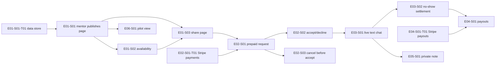

# 📋 `om-backlog .ai/specs/product-brief.md --dry-run` — 2026-10-16

**Dry run: nothing was written to the tracker.** Ids are provisional. Tracker dedupe was skipped.

## Podsumowanie (PL)

- **Drzewo:** 6 epików „Now” + 1 zaparkowany (Later), 11 stories, 5 tasków (3 techniczne, 2 badawcze).
- **Pierwsza paczka:** E01-S01-T01 → E01-S01 → E01-S02 → E01-S03 (strona mentora pod linkiem). Nie dotyka pieniędzy (Q01/Q02/Q04/Q05 nie blokują), a to, czy mentor opublikuje stronę, jest najbardziej ryzykownym założeniem (A02, podaż mentorów). Potem E02-S01/S02 na Stripe w trybie testowym.
- **Blokery:** Q10 (uprawnienia właściciela, potwierdzenie D01–D09) i Q11 (czy zmieści się w 25 h) blokują realne filowanie. Q01/Q02/Q04/Q05 blokują prawdziwe płatności. Q03 blokuje zaproszenia mentorów. Q09: 9 z 11 stories ma `risk-high`, a nikt nie pełni roli QA.
- **Rozmiar:** 6 epików to więcej niż wytyczna (1–5). Kandydaci do Later: E05 (notatki; decyzja właściciela, bo D01 trzyma je w 1.0) i E06-S01 (widok pilotażu, zastępowalny ręcznym eksportem).
- **SDLC.md nie ma Definition of Ready**, więc formalny readiness check pominięty (dodaje go `om-setup-discovery-pipeline`). Nieformalnie: problemy i grupa docelowa mają oparcie w wywiadach i danych, więc wariant badawczy nie zastępuje backlogu; częściowo użyty jako E06-T01/T02.
- **Do ustalenia (brief nie rozstrzyga):** gość czy konto mentee, logowanie mentora, powiadomienia o zgłoszeniu/akceptacji, strefa czasowa slotów, czy mentor musi oferować obie długości, blokowanie slotu przy oczekującym zgłoszeniu, konflikt R09/R10 gdy nikt nic nie napisze, moment wypłaty, dostęp do czatu po slocie, notatka bez odpowiedzi mentee.
- **Poza zakresem Now, ale do poprawy:** README opisuje inny produkt (Q08).

## Outcome after these epics

- An invited senior engineer can publish a page reached only through their own link.
- A developer with that link can send a prepaid question for a 25- or 50-minute slot.
- The mentor can accept or decline it, and the two hold a text-only session.
- Refunds and no-shows settle automatically.
- The mentor sets up payouts after the first paid request and can keep a private note the mentee approved.
- The founders can read the pilot's per-mentor record (D09).

## Readiness (informal)

- Problems and Target group rest on tiers 1–5: seven interviews `[INTERVIEW]`, one Discord export and one survey `[DATA]`, zero `[SYNTHETIC]`.
- D01–D09 and N03–N05 are `active`, but accepted on a blanket instruction, not reviewed one by one (Q10).
- Q11 (25-hour limit) blocks committing to the build; this tree is its sizing input.
- Q01, Q02, Q04, Q05 block real payments, not building: E02–E04 in Stripe test mode only until answered.
- Q03 must be answered before the first invitation (D09).

## Held back

- **Guest checkout without an account** — Key flow step 3 is `[ASSUMPTION]` with no decision; E02-S01 is neutral on account vs guest.
- **Any promise of a response time** — A01 untested; the pilot measures it.

## Dependency order

## Tree

### E01 — Mentor page reached by share link (risk-high)
- **E01-S01-T01** Data store and first schema migration (mentors, invitations, pages). risk-high (migration).
- **E01-S01** An invited mentor publishes their page within 20 minutes without payout details. risk-high (auth). 5 AC. ← T01. D03, D07, D08, D09, R03, R07, R13, N02.
- **E01-S02** A mentor publishes availability, and only those slots are offered. risk-medium. 3 AC. ← E01-S01. D02, R01, R06.
- **E01-S03** A developer opening a share link sees who the mentor is, prices and open slots, no ratings. risk-medium. 4 AC. ← E01-S01, E01-S02. D03, R03, R07, R14, N02.

### E02 — Paid request and the mentor's decision (risk-high; Stripe test mode until Q01/Q02/Q04/Q05)
- **E02-S01-T01** Stripe card payment, refund operation and payment webhook. risk-high.
- **E02-S01** A developer sends a prepaid request with their question within 5 minutes. 5 AC. ← E01-S03, E02-S01-T01. D02, D04, D08, R05–R08.
- **E02-S02** Mentor reads the question and accepts or declines; decline or no answer before the slot refunds automatically. 5 AC. ← E02-S01. D02, D05, R05, R09.
- **E02-S03** A developer can cancel for a full refund until the mentor accepts. 3 AC. ← E02-S01. D05, R11.

### E03 — Live text session and no-shows (risk-high)
- **E03-S01** Mentor and developer hold the session as a live text chat in the booked slot. 4 AC. ← E02-S02. D02, R01, R02, R04, N01.
- **E03-S02** When someone does not show, money goes where the rules say, automatically. 3 AC. ← E03-S01, E02-S01-T01. D05, R09, R10. **Blocked:** R09 vs R10 when neither posts.

### E04 — Mentor payout (risk-high)
- **E04-S01-T01** Stripe payout onboarding for mentors.
- **E04-S01** After the first paid request a mentor sets up payouts and receives the money owed. 4 AC. ← E02-S01, E03-S02, E04-S01-T01. D07, R09, R10, R13.

### E05 — Private session notes (risk-high) — candidate for Later, owner's call
- **E05-S01** A mentor can leave a private note after the session, kept only if the developer approves. 6 AC. ← E03-S01. D06, R04, R12, N04.

### E06 — Pilot with the first mentors (D09)
- **E06-S01** A founder sees each invited mentor's pilot record without seeing session content. 4 AC. ← E01-S01. D09, R04.
- **E06-T01** Research: mentors' weekly hours, answer speed, rate, employer permission (collection plan 2). Owner/date unknown.
- **E06-T02** Research: how often developers are stuck, who pays, would they paste code to a stranger (collection plan 3). Owner/date unknown.

### E07 — Later (parked, not filed as stories)
Vault subscription, MCP, AI answers, Obsidian export (N03); publishing notes (N04); opt-in directory and search (D03); async "reply within 24h" (D02); company invoicing, team plans, session packs (D04, A07); non-rating trust signal. Never filed: N01–N05.

## Acceptance criteria (stories)

**E01-S01**
- Given a founder has created an invitation, When the mentor opens it, Then they can set up their page without any payout or bank details (R13, D07).
- Given the mentor saves a public-work link, a plain description and prices, When they publish, Then the page is live and they see its share link (R03, R07, D03).
- Given the public-work link or description is empty, When publishing, Then it is refused and names the missing field (R03). (negative)
- Given a person with no invitation, When they try to create a mentor page, Then they cannot (D09). (negative)
- Given a first-time mentor, When timed from invitation to share link, Then ≤ 20 minutes (D08, provisional).

**E01-S02**
- Given a published page, When the mentor adds availability windows, Then the share page offers 25/50-min slots only inside them (R06, R01).
- Given the mentor removes a window, Then no slot from it is offered (R06). (negative)
- Given no availability published, Then no slot can be chosen (R06). (negative)

**E01-S03**
- Given a published page, When a developer opens the share link, Then they see public-work link, description, 25/50 prices and open slots before any question field (R03, R07).
- Then the page shows no rating, review, score or rating filter (R03, N02). (negative)
- There is no list, directory or search of mentors; a page is reached only by its link (R14, D03). (negative)
- Given a link to an unpublished page, Then no mentor data is shown. (negative)

**E02-S01**
- Given a share page, When the developer writes a question, picks length and slot and pays by card, Then a request awaiting the mentor exists and is confirmed (R05, R06, R08).
- The amount equals the mentor's price for that length as shown up front (R07).
- Given payment fails or is abandoned, Then no request reaches the mentor and nothing is charged (R08). (negative)
- Given an empty question, Then sending is refused (R05). (negative)
- Given a first-time developer, link → confirmation ≤ 5 minutes (D08, provisional).

**E02-S02**
- Mentor sees question, length and slot before accept/decline (R05).
- On accept a session exists and the developer sees it accepted (R05).
- On decline the developer is refunded in full automatically the same day, no ticket (R09). (negative)
- If not accepted when the slot starts, the request lapses and is refunded automatically (R09). (negative)
- A refunded/cancelled request cannot be accepted (R05, R09). (negative)

**E02-S03**
- Cancel before acceptance → full automatic refund, mentor no longer sees it open (R11).
- After acceptance → no refund (R11). (negative)
- Cancel and accept at nearly the same moment → exactly one takes effect (R11).

**E03-S01**
- In the slot both parties see each other's messages live for 25/50 min (R01, D02).
- Every session screen says text only, no video/voice control (R02, N01).
- A third person sees none of the messages (R04). (negative)
- Every post is recorded with its time for the no-show rule (D05).

**E03-S02**
- Mentor posted nothing, developer did → full automatic refund that day (R09, D05).
- Developer posted nothing, mentor did → mentor keeps payment (R10). (negative)
- Both posted → session held, no refund (R09, R10).

**E04-S01**
- First paid request without payout details → mentor asked to complete setup; page and requests keep working (R13, D07).
- Money owed without payout details → held, no payout attempted (R13, D07). (negative)
- Setup complete → money owed is paid out (R13).
- Refunded requests → nothing paid out (R09). (negative)

**E05-S01**
- Mentor writes a short note → developer asked to approve or reject (R12).
- Approved → saved under mentor's name, visible only to the two (R12, R04).
- Rejected → not kept (R12). (negative)
- Mentor deletes an approved note → neither sees it (R12).
- Nobody else sees it; never published (R04, N04). (negative)
- No note → session and payment unaffected (R12).

**E06-S01**
- Per mentor: invitation accepted, page published, availability set, requests started/paid/accepted/held, time to acceptance and to start, notes written/approved/rejected/deleted (D09).
- Shows paid sessions held per invited mentor (primary metric).
- Shows no question, chat or note content (R04). (negative)
- Mentors and developers cannot open it (R04). (negative)

## Self-review (Scope "Now", no AI slop, dependencies)

- Dropped untraced/ambiguous criteria: "mentor must set both prices" (R07 vs R01 → open question), "hidden from search engines" (R14 is in-product only), "edit only own page" and generic idempotency (covered by SDLC risk-high gates), "mentee's stated deadline" field (no rule).
- No invented tasks: real-time transport, notifications, mentor auth method stay open questions; README fix (Q08) not filed (not in Scope "Now"). Story tasks only for migration, Stripe payments, Stripe payouts.
- Contradiction surfaced: R09 vs R10 when neither party posts — E03-S02 blocked on an owner decision.
- Every story names predecessors; refund operation in E02-S01-T01 reused by E02-S02, E02-S03, E03-S02.
- Every criterion carries a trace id; every story has at least one negative case.

Next: om-backlog .ai/specs/product-brief.md
