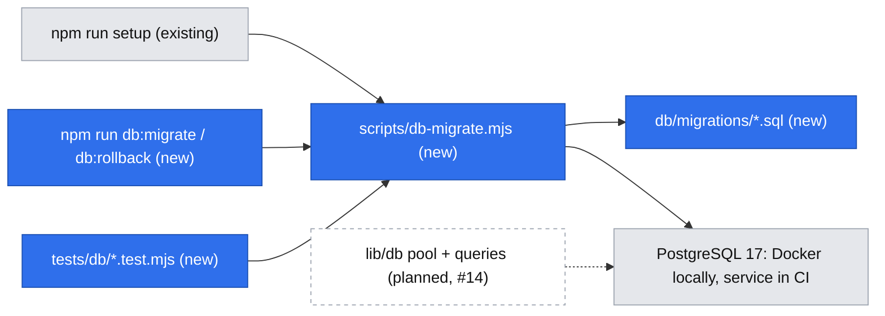
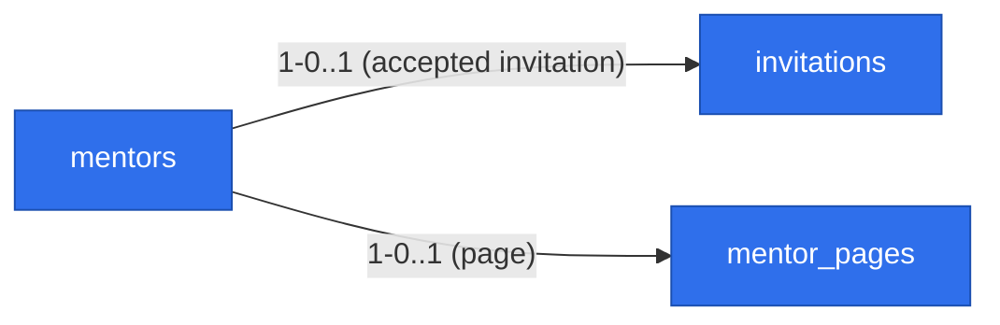

# Data store and first schema migration (mentors, invitations, mentor pages)

Issue: #23 (E01-S01-T01) · Story: #14 · Epic: #8 · Risk: `risk-high` (first schema migration)

## 📝 TLDR

Every 1.0 story (#14 mentor publishes a page, #15 availability, #16 share page, #17–#19 prepaid requests, #24 Stripe) needs stored data, and today the app has a local PostgreSQL container but no driver, no migrations and no schema. This spec proposes (future behavior) PostgreSQL 17 accessed through `pg`, with plain-SQL up/down migrations run by `node-pg-migrate`, a first migration creating `mentors`, `invitations` and `mentor_pages`, and a migration test that runs up → down → up against a real database locally and in CI. It fixes the conventions later specs extend; it designs none of their tables.

## Resolved assumptions (autonomous defaults)

| # | Question | Chosen answer | Rationale | Flag |
|---|---|---|---|---|
| Q1 | Which ORM / migration tool? | No ORM. `pg` driver + `node-pg-migrate` with `.sql` migration files carrying an explicit `-- Down Migration` section. | `BACKWARD_COMPATIBILITY.md` requires migrations tested **up and down**; Prisma Migrate and drizzle-kit generate no down migrations. Plain SQL, runnable from the existing `node --test` `.mjs` suite without a TS loader. | Accepted on owner's blanket yes (2026-10-19, grill Q1) |
| Q2 | Does #23 bundle independently deployable capabilities (store setup vs. schema)? | No split. | Neither is useful alone: the tooling without a schema has nothing to test, the schema without tooling cannot run. The issue defines them as one task. | — |
| Q3 | Mentor sign-in / auth tables in this migration? | No. #14 chooses the sign-in method and adds whatever it needs (session table, provider ids) in its own migration. | Sign-in is an open question on epic #8; designing it here would pre-empt #14. `mentors.email` is the only identity field this schema commits to. | — |
| Q4 | Price and currency columns in 0001? | No. #14's migration 0003 adds `price_25_minor`, `price_50_minor`, `currency` (shared cross-spec decision). | Keeps open product decisions (Q02, both lengths) out of the first migration; adding columns is non-breaking. | ⚠ Q02 currency and "both lengths" stay open — tracked in #14 |
| Q6 | How is the invitation secret stored? | Only a SHA-256 hash of a ≥128-bit random token; plaintext lives only in the link. Expiry per row, value set by #14. | A leaked row cannot be replayed as an invitation (D09). | — |
| Q7 | How do migration tests get a database without disturbing dev data? | A disposable schema `dm_migtest_<random>` in the database at `DATABASE_URL`, marked with `COMMENT ON SCHEMA … IS 'devmentor-migration-test'`; migrations and the tests' queries run with `search_path` set to it; dropped at the end. Leftovers from crashed runs are dropped only when **both** prefix and comment match — no other schema is ever touched. CI gets a `postgres:17` service. Locally an unreachable DB **skips** with a message; with `CI=true` it **fails**. | No new env var or second database; `public` and foreign schemas are never touched; CI cannot silently skip the risk-high gate. | Accepted (grill Q2) |
| Q8 | Production hosting and migrate-on-deploy? | Out of scope; no deployment exists. Migrations are applied explicitly with `npm run db:migrate`, never from `next build`. | Hosting is not decided in the brief; any managed PostgreSQL 17 works with this design. | — |
| Q9 | Who creates invitations (admin UI, script)? | Out of scope; #14 decides. This task ships only the table. | The pilot (D09) is a handful of warm contacts; the founders' tool is a #14 decision. | — |

## 📝 Problem Statement

`README.md` and `npm run setup` already start `postgres:17` and define `DATABASE_URL`, but nothing in the app talks to it: no driver, no migration tool, no schema, no way to test a migration. Story #14 (and through it #15–#19, #24) is blocked on this (`backlog.md`: E01-S01 depends on E01-S01-T01). Because schema and migrations become a protected surface the moment the first one merges (`BACKWARD_COMPATIBILITY.md`, "Przyszłe powierzchnie"), the conventions chosen here bind every later spec.

## 📝 Proposed Solution

- **Store:** PostgreSQL 17 (already the documented local DB; `gen_random_uuid()` is built in, no extensions needed).
- **Access:** `pg` (node-postgres), parameterized SQL only. The runtime pool is created by #14 with its first query; nothing in #23 reads data at runtime.
- **Migrations:** `node-pg-migrate`, files in `db/migrations/NNNN_<name>.sql`, each with `-- Up Migration` and `-- Down Migration`. Applied history lives in the tool's `pgmigrations` table. A thin wrapper `scripts/db-migrate.mjs` exports `migrate({ databaseUrl, direction, count, schema })` and is the single entry used by the npm scripts, `npm run setup` and the tests (same pattern as `scripts/setup.mjs`: logic exported, tested with `node:test`). When run from the CLI it loads `.env.local` with `process.loadEnvFile` (Node ≥ 20.12; `package.json` gains `engines.node: ">=20.12"` and README's requirement is raised from 20.9). Migrations run with the tool's default one transaction per migration.
- **New npm scripts:** `db:migrate` (all pending up), `db:rollback` (one down). Existing scripts unchanged.

Alternatives rejected: Prisma and Drizzle (no down migrations; Drizzle also needs a TS loader), Kysely Migrator (TS migrations; may return later as a query layer over `pg`), a hand-rolled runner (reinvents ordering, locking, history).

## 📝 Architecture

Takeaway: one migration entry point serves setup, CLI and tests; app runtime access arrives with #14.

Cross-system effects:

- **CI (`.github/workflows/ci.yml`):** the `test` job gains a `postgres:17` service with a health check and `DATABASE_URL` pointing at it. `npm test` stays the command; `tests/**/*.test.mjs` already picks up `tests/db/`. Strengthens the gate, does not weaken it.
- **`npm run setup`:** a new last step "Migracje bazy (db:migrate)", after `.env.local` exists; always runs (the tool skips applied migrations, so it stays idempotent). It retries the connection for a few seconds because a freshly started container is not immediately ready.
- **`next build`:** never needs a database. Later specs must keep DB reads in request-time code paths (`cacheComponents` is on in `next.config.ts`).

## 📝 Data Model

Migration `0001_mentors_invitations_pages`. All ids `uuid default gen_random_uuid()`, all times `timestamptz` (UTC), `created_at`/`updated_at default now()` (`updated_at` set by the app; no triggers).

**`mentors`** — a person allowed to have a page. Private: never rendered on public pages.

| Column | Type | Rule |
|---|---|---|
| `id` | uuid | PK |
| `email` | text | not null; unique index on `lower(email)` |
| `created_at`, `updated_at` | timestamptz | |

**`invitations`** — a founder's invitation; the only way a `mentors` row comes to exist (D09).

| Column | Type | Rule |
|---|---|---|
| `id` | uuid | PK |
| `email` | text | not null (the address invited) |
| `token_hash` | text | not null, unique (SHA-256 of the link token) |
| `expires_at` | timestamptz | not null |
| `accepted_at` | timestamptz | null until accepted |
| `revoked_at` | timestamptz | null |
| `mentor_id` | uuid | FK → `mentors.id` `on delete cascade`, unique, null until accepted |
| `created_at` | timestamptz | |

CHECK: `(accepted_at is null) = (mentor_id is null)`; CHECK: not both `accepted_at` and `revoked_at`.

**Invitation contract (split of ownership).** The DB guarantees: token hash unique; accepted ⇔ linked to a mentor; never both accepted and revoked; at most one invitation per mentor. #14 owns the lifecycle and must test it: expired or revoked invitations are refused; acceptance is single-use, behind a confirm button (a `GET` never consumes); the new `mentors.email` is **copied from `invitations.email` inside the acceptance transaction**, never taken from input — so a token cannot attach to a different identity. Several open invitations for one email are allowed; the first accepted wins and #14 refuses the rest ("mentor exists"). No cross-table trigger.

**`mentor_pages`** — the public page behind a share link (1–1 with a mentor).

| Column | Type | Rule |
|---|---|---|
| `id` | uuid | PK |
| `mentor_id` | uuid | FK → `mentors.id` `on delete cascade`, unique |
| `slug` | text | not null, unique; CHECK `^[a-z0-9](?:[a-z0-9-]{1,38}[a-z0-9])$` — the share-link path segment, 3–40 chars by intent |
| `display_name` | text | null on draft |
| `public_work_url` | text | null on draft |
| `description` | text | null on draft |
| `published_at` | timestamptz | null = draft |
| `created_at`, `updated_at` | timestamptz | |

CHECK `published_requires_content`: when `published_at is not null`, then `display_name`, `public_work_url`, `description` are non-blank (R03). #14 extends it for prices (R07, Q4) when it adds them. The app validates first and names the missing field; the CHECK is the backstop.

Deliberately absent: rating/review columns (R03, N02), any directory/listing flag (R14, D03), payout or bank fields (R13, D07). Splitting `mentors` (private email) from `mentor_pages` (public content) keeps a page query from ever selecting PII.

No existing entities: the repository has no schema yet.

**Down migration:** `drop table mentor_pages; drop table invitations; drop table mentors;` (reverse dependency order). `db:rollback` is documented (README, script help) as a **local/test-only** command. No code guard now — no deployed database exists; the first deployment spec adds one. Once real data exists, a rollback is a forward-fix migration.

**Migration numbering (shared):** 0001 this spec · 0002–0003 #14 (sign-in; prices + currency) · 0004 #15 (availability, `mentors.time_zone`) · 0005 #24 payments · 0006+ #17 requests and later. Payout references arrive only with #25 (R13).

## 📝 Edge Cases & Failure Scenarios

- **DB not running locally:** `npm run db:migrate` exits non-zero with "Baza nie odpowiada pod DATABASE_URL — uruchom `docker compose up -d`"; `npm test` skips the DB tests with the same hint. With `CI=true` the DB tests fail instead of skipping.
- **Container started but not ready (setup):** the migrate step retries briefly, then fails with the same message; re-running `npm run setup` resumes.
- **Migration fails halfway:** each migration runs in its own transaction (tool default; PostgreSQL DDL is transactional), so the failing migration is not half-applied and is not recorded in `pgmigrations`; earlier ones in the same run stay applied.
- **Two processes migrate at once:** the tool's advisory lock serializes them; the second sees nothing pending.
- **Edited, already-applied migration:** the tool does not detect it (no checksums); forbidden by convention and review — ship a new migration. Renamed or reordered files do fail the tool's order check.
- **Port 5432 taken / custom URL:** everything reads `DATABASE_URL`; README's existing note applies.

## 📝 Risks & Impact Review

- **Hard to reverse:** the tool choice (Q1, ⚠) and the shape of `mentors` / `mentor_pages`, which every story reads. Mitigated by plain SQL (portable to any later tool) and by deferring auth, availability and money tables to their specs.
- **Contract surfaces (`BACKWARD_COMPATIBILITY.md`):** this PR moves "Schemat bazy i migracje" from "Przyszłe" to the "dziś" table, adds `db:migrate` / `db:rollback` to the protected npm scripts, and touches the CI workflow (adds a service, removes nothing). `DATABASE_URL` keeps its name and meaning; no new env var.
- **SDLC `risk-high` gate:** migration test up and down (Step 2) and a rollback plan in the PR body ("`npm run db:rollback` reverts 0001; no production data exists yet"). Not `skip-qa`: SDLC forbids self-QA on schema migrations, so the PR carries `needs-qa` for a QA reviewer (who checks the migration test evidence and `npm run setup` on a clean machine) or states a maintainer's explicit exception; plus a second person's review.
- **Sensitive data:** `mentors.email` and `invitations.email` are the only PII; invitation tokens are stored hashed; no payout data (R13). Legal ownership (brief Q04) is open and does not block building.

## 📝 Decisions in play

Relies on D03/R14, D07/R13, D09, R03/N02, R07 (prices deferred to #14). Leaves open Q02 and "both lengths" (in #14). Supersedes nothing. Owner: Krzysztof Marczak.

## 📋 Phasing

Phase 1 (single PR closing #23): data store, first migration, tests, CI and docs. Not split further: each half alone ships nothing testable.

## 📋 Implementation Plan

**Phase 1 — Data store and migration 0001**

1. **Tooling.** Add `pg` and `node-pg-migrate` (exact versions pinned). Add `scripts/db-migrate.mjs` (exported `migrate()`, CLI entry loading `.env.local`, readable error when the DB is unreachable) and npm scripts `db:migrate`, `db:rollback`; empty `db/migrations/`. Test: unit test of the wrapper's argument/error handling with an injected runner (no DB). App still builds; nothing reads the DB.
2. **Migration 0001 + migration test.** Add `db/migrations/0001_mentors_invitations_pages.sql` per the Data Model. Add `tests/db/migrations.test.mjs`: in a disposable schema run up → assert the three tables exist → down → assert none remain → up again. Add `tests/db/schema.test.mjs` for the constraints that encode business rules: publishing without `public_work_url` or `description` is rejected (R03); duplicate `slug` and differently-cased duplicate `email` are rejected; an invitation with `accepted_at` but no `mentor_id` is rejected; deleting a mentor removes their page and invitation. Harness test: a pre-existing schema `test_x` without the marker survives cleanup. Skip/fail behavior per Q7.
3. **CI and setup.** Add the `postgres:17` service and `DATABASE_URL` to `.github/workflows/ci.yml`; add the migrate step (with connection retry) to `scripts/setup.mjs` and extend `tests/setup.test.mjs` with the fake-exec pattern already there. Test: setup unit test for the new step; the `CI=true` fail-instead-of-skip rule (Q7) guarantees the DB tests run in CI.
4. **Docs and contracts.** README: migration commands, `db/` in the project structure, scripts table. `BACKWARD_COMPATIBILITY.md`: move the schema/migrations row to "dziś", add the two npm scripts. `.ai/agentic.config.json` and `SDLC.md` unchanged (validation commands unchanged). README marks `db:rollback` local/test-only and raises Node to ≥ 20.12. PR body: rollback plan.

## 🔍 Review & grill outcome

GPT review → decisions:
- **Decision needed, Q1 tooling:** accepted — `pg` + `node-pg-migrate` confirmed on owner's blanket yes (grill Q1).
- **High, `test_%` cleanup can delete foreign schemas:** accepted — `dm_migtest_` prefix + schema comment marker, cleanup requires both; harness test added (Q7).
- **High, invited identity not enforced:** accepted — mentor email is copied from the invitation inside #14's acceptance transaction ("Invitation contract"), tested in #14. A DB trigger was cut as over-engineering.
- **Medium, rollback guard is only a convention:** accepted in part — `db:rollback` documented local/test-only; a code guard is cut until a deployed database exists.
- **Medium, invitation lifecycle boundary unclear:** accepted — DB invariants listed here, lifecycle behaviour assigned to #14.
- **Low, repetition:** accepted — alternatives table, future-tables table, duplicated ⚠ rows and "Decisions in play" trimmed.

Grill (`reviews/2026-10-19-data-store-and-first-schema-migration.grill.md`): 2 rounds, 6 questions, all accepted on owner's blanket yes; none newly ⚠. Still ⚠ but owned by #14: Q02 currency, both lengths required. Shared cross-spec decisions applied: migration numbering, hashed ≥128-bit tokens.
