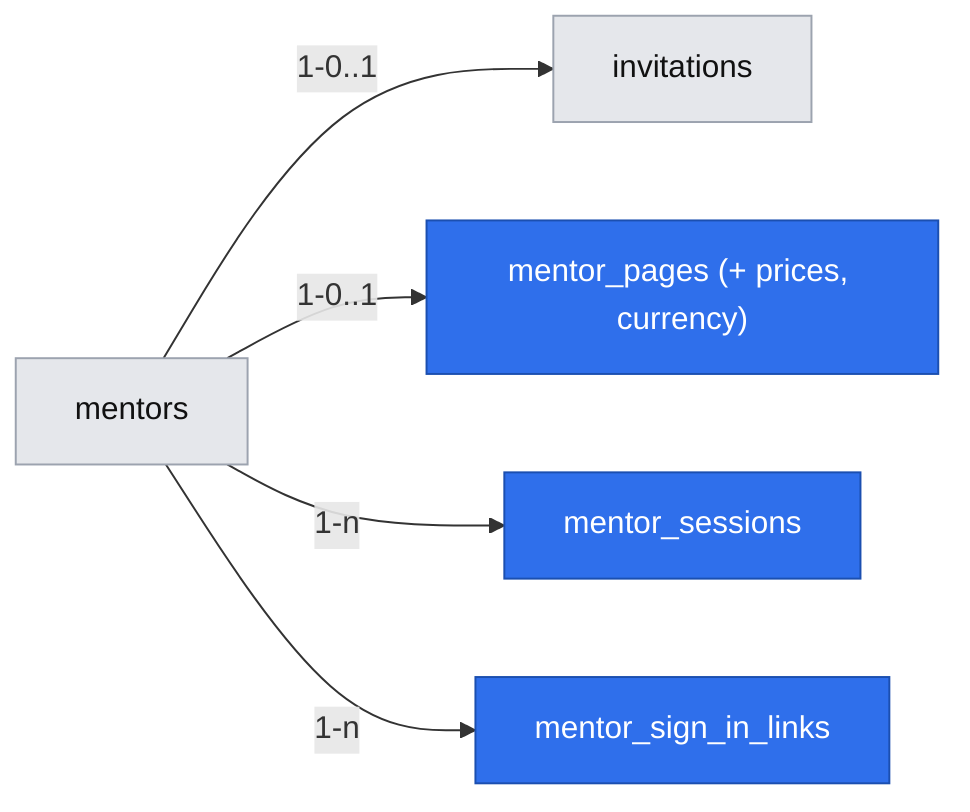

# Mentor invitation, sign-in and page publishing

Issue: #14 (E01-S01) · Epic: #8 · Depends on: #23 (spec `2026-10-19-data-store-and-first-schema-migration.md`) · Risk: `risk-high` (sign-in, sessions, schema)

## 📝 TLDR

A founder can invite a senior engineer to DevMentor, but today nothing exists between the `invitations` table (#23) and a page a developer can open. This spec proposes (future behavior) that a founder generates an invitation link with one command, the mentor opens it, confirms with one click, lands signed in on a single form (name, public-work link, description, 25- and 50-minute prices), presses **Publish** and sees the share link — in under 20 minutes, never asked for payout or bank details (R13, D07, D08). Mentors get no password: the invitation link signs them in, and a founder can issue a fresh sign-in link if the cookie is lost.

## Resolved assumptions (autonomous defaults)

> **2026-10-19 — owner confirmation:** Krzysztof Marczak confirmed every ⚠ item in this spec as written (chat: „Potwierdzam wszystkie decyzje ⚠ ze specyfikacji lekcji 05 tak, jak są zapisane”). Remaining ⚠ marks below are historical.

| # | Question | Chosen answer | Rationale | Flag |
|---|---|---|---|---|
| Q1 | How does a mentor sign in (open on epic #8)? | No passwords. Accepting the invitation creates a database-backed session (httpOnly cookie, 30 days). Re-entry: a founder runs `npm run mentor:sign-in-link -- <email>` and sends the single-use link personally. #14 does **not** depend on the email adapter #17 introduces; sending sign-in links through it is a later swap that keeps the session model. | Pilot is ~20 warm contacts (D09) whom founders message directly; zero new dependencies or secrets; sessions are revocable rows; #14 ships before #17. | Accepted on owner's blanket yes, 2026-10-19 (grill Q1) |
| Q2 | Currency (brief Q02, open)? | One platform currency, `PLN`, stored per page in `mentor_pages.currency`; the mentor does not choose it. | Interviewees and pilot mentors are Polish and quote prices in zł; the per-page code is a cheap hedge for Q02 (more currencies later without a data migration), not an acceptance criterion. | ✅ CONFIRMED by Krzysztof Marczak (2026-10-19) (Q02, owner) |
| Q3 | Must a mentor offer both 25 and 50 minutes (epic #8)? | Yes: both prices required to publish. | R07 literal reading; the #23 recommendation; a CHECK is easier to drop than to add. | ✅ CONFIRMED by Krzysztof Marczak (2026-10-19) (epic #8 open question) |
| Q4 | Is the price the mentor enters what the mentee pays, and is commission (Q01) shown? | The entered price is the full price the mentee pays (R08). No commission or "you receive" figure is shown. | Q01 is open; showing a number now would publish an unmade decision. E04 shows net amounts. | ✅ CONFIRMED by Krzysztof Marczak (2026-10-19) (Q01, owner) |
| Q5 | Who creates invitations and how? | Founders, from a CLI: `npm run mentor:invite -- <email>` prints the link; expiry 14 days. No admin UI. | Smallest surface for a pilot of ~20 invitations (D09); no admin role or screen to secure. Not doing (2026-10-20): no founder screen; the prototype only simulates the CLI step and does not set scope (L11, Z12). | — |
| Q6 | Share-link shape and slug rules? | `/m/{slug}`. At acceptance the draft gets a neutral random placeholder (`mentor-` + 6 lowercase base32 chars); the email is never used. Until first publish the editor suggests a slug from the display name and the mentor can edit it — the field shows the placeholder, and the name suggestion overwrites it until the mentor edits the field by hand (L9, Z10, P6); immutable after (a published slug is a public URL, `BACKWARD_COMPATIBILITY.md`). | Readable, stable link (D03) without leaking part of a private email. | Accepted (grill Q8) |
| Q7 | Unpublish / delete page? | Not in this story. A founder can unset `published_at` in SQL if needed. | Not in the acceptance criteria; smallest scope. | — |
| Q8 | Does the public page itself ship here? | No. #16 renders `/m/{slug}`. This story ends at "published + share link shown". Founders do not send invitations before #16 is merged. | One capability per spec; #16 depends on #14 already. | — |
| Q9 | UI language? | Polish copy, matching the existing app (`lang="pl"`), without gendered forms (DS rule C12; W2, Z24). | Pilot mentors are Polish warm contacts; copy is cheap to change. | — |
| Q10 | Page preview before publishing? | Not doing in 1.0 (2026-10-20). | After publish the share link opens the real page and edits are live at once (story 3); pilot question H4 below. | L13, Z14 |
| Q11 | Warn about unsaved changes when switching Strona ↔ Dostępność? | Not doing in 1.0 (2026-10-20). | One save button per screen; rare switches are observed in the pilot. | L21, Z22 |
| Q12 | Loading states (Skeleton, button `loading`)? | Follow the design system; no separate acceptance criterion (2026-10-20). | Visual only; covered by DS stories (gap D9). | Z29 |

## 👤 User stories

1. **Invited mentor, first visit.** Anna, a staff engineer from the founders' list, got a message from a founder with a link. She opens it on her laptop between meetings and **sees** „Zespół DevMentora zaprasza cię do DevMentora” (no founder name; L2, Z2) and one button, **Akceptuję zaproszenie** — no form, no password, no bank fields. She clicks; the **system** marks the invitation accepted, creates her mentor record and an empty draft page, signs her in and opens the page editor. **Next:** she fills her page.
2. **Mentor fills and publishes the page.** On one screen Anna **sees** five fields — display name, link to public work, "what I have done" description, price for 25 min, price for 50 min (in zł) — plus the link suggested from her name as she types it, `devmentor…/m/anna-k`. She pastes her GitHub URL, writes three sentences, types 150 and 280, and presses **Publish**. The **system** validates everything server-side; if a field is missing it keeps her input and names the field ("Dodaj link do publicznej pracy"). When valid, it sets the page live and **shows** the share link with a **Copy** button and a hint "Wklej go tam, gdzie ludzie już cię pytają". **Next:** she posts the link in her Slack/Discord (D03), then sets availability (#15).
3. **Mentor comes back later.** Anna returns a week later on the same browser and is still signed in; she edits the description and saves — the change is live, the link unchanged. On a new laptop she has no session: `/mentor` **shows** "Dostęp tylko przez zaproszenie — poproś zespół o link do logowania". A founder runs one command and sends her a sign-in link; she clicks **Zaloguj** and is back in the editor.
4. **Someone without an invitation.** A developer guesses `/mentor` and **sees** the "invitation only" message; someone who reuses Anna's already-accepted invitation link (no session) **sees** the neutral „Ten link jest nieaktywny — poproś zespół o nowy” (L3, Z4); there is no sign-up form anywhere; nothing is created (D09).
5. **Founder.** Before the pilot, a founder runs `npm run mentor:invite -- anna@example.com`, gets a link valid 14 days and sends it personally (warm contact, D09).

## 📝 Problem Statement

The pilot (D09) starts by inviting warm-contact mentors, and its first observation is whether they publish a page. Mentors set hard conditions: setup "dwadzieścia minut. max" and no account number before any booking (Python mentor, 2026-09-03), their own price (D04), no ratings (N02), only reachable through their own link (D03). #23 created the tables but no way to invite, sign in, edit or publish, and deliberately left prices, sign-in and invitation creation to this story.

## 📝 Proposed Solution

- **Invitation acceptance** is a two-step page, never a side effect of `GET`: link previews and mail scanners must not consume a single-use token. `/invite/[token]` shows the button; a server action does the work in one transaction.
- **Sessions** are rows in `mentor_sessions` keyed by a SHA-256 hash of a random cookie token (same pattern as invitation tokens in #23). A Data Access Layer `getCurrentMentor()` (server-only) is the single gate every mentor page and server action calls; the mentor id is never taken from client input.
- **Page editor** at `/mentor`: one form, Save draft and Publish. Publish runs the full validation; Save draft accepts partial content. After publish, edits are allowed but must keep the page publishable (same validation on save).
- **Founder CLI** `scripts/mentor-links.mjs` (pattern of `scripts/setup.mjs`: exported functions, thin CLI) with npm scripts `mentor:invite` and `mentor:sign-in-link`; prints the URL built from `NEXT_PUBLIC_APP_URL`.

Alternatives considered: email+password (adds reset flow and credential storage for ~20 users); magic links by email (needs a provider, DNS and a secret — Later); stateless sealed cookies, e.g. iron-session (new dependency and secret env var, no server-side revocation); OAuth via GitHub (mentors' "GitHub is my profile" makes it tempting, but adds a third-party app and secrets — a good Later option). Topmate's single-link expert page confirms the shape: one page, own price, own link.

## 📝 Architecture

- New: `app/invite/[token]/page.tsx`, `app/sign-in/[token]/page.tsx`, `app/mentor/page.tsx` (+ server actions), `lib/db` pool (first runtime query, as #23 planned), `lib/auth/session` (DAL: `getCurrentMentor`, `startSession`, `endSession`), `lib/mentor-page/validate.mjs` (pure validation, tested by `node --test`, precedent `lib/math.mjs`), `scripts/mentor-links.mjs`.
- Session reads happen at request time inside a Suspense boundary (`cacheComponents` is on; see `node_modules/next/dist/docs/01-app/02-guides/authentication-with-cache-components.md`). No `proxy.ts`: the DAL check in each page/action is the authority.
- Consumers: #15 adds `/mentor/availability` behind the same `getCurrentMentor()`; #16 reads `mentor_pages` (published only) for `/m/[slug]`; E02 mentor-side screens (accept/decline, #18) reuse the session DAL.

## 📝 Data Model

Two additive migrations, one per phase: `0002_mentor_sign_in` (sessions, sign-in links) and `0003_mentor_page_prices` (prices, currency). Numbers are the next free ones at merge time — `node-pg-migrate` rejects a file ordered before an applied one, so parallel specs (#15, E02) must renumber on rebase.

**`mentor_pages`** — new columns:

| Column | Type | Rule |
|---|---|---|
| `price_25_minor` | integer | null on draft; CHECK `> 0` |
| `price_50_minor` | integer | null on draft; CHECK `> 0` |
| `currency` | text | not null default `'PLN'`; CHECK `^[A-Z]{3}$` |

Prices are integer minor units (grosze), the unit Stripe takes (#24); #16 and #17 read these exact column names. The UI accepts whole złoty 20–5000 (app-level bounds against typos; DB only enforces `> 0`). Constraint `published_requires_content` is replaced by one that also requires both prices non-null. Replacing a CHECK is a narrowing; it is safe in one step only because no published row exists in any environment yet (no deployment) — the migration fails loudly otherwise.

**`mentor_sessions`** (new): `id` uuid PK · `mentor_id` FK → `mentors` on delete cascade · `token_hash` text unique not null · `expires_at` timestamptz not null (created + 30 days, no sliding) · `revoked_at` timestamptz null · `created_at`.

**`mentor_sign_in_links`** (new): `id` uuid PK · `mentor_id` FK → `mentors` on delete cascade · `token_hash` text unique not null · `expires_at` (created + 72 hours) · `used_at` timestamptz null · `created_at`.

Each down reverses its own up: 0002 drops the two tables; 0003 drops the three columns and restores the #23 CHECK. Sensitive data: only token hashes; no payout or bank columns (R13).

## 📝 API Contracts

Server actions (not public HTTP APIs); all derive the mentor from the session.

Token links (invitation, sign-in) follow the shared rule: 32 random bytes (base64url), only SHA-256 hashes stored, single-use, expiry stated in the link page; `GET` only renders a confirm button, the server action consumes.

- `acceptInvitation(token)` — one transaction, invitation row locked `for update`: exists, not expired, not revoked, not accepted → create `mentors` with the email **copied from the invitation** (never from input; if a mentor with that email exists, refuse with the same neutral message as an inactive link, „Ten link jest nieaktywny — poproś zespół o nowy” — a separate text would reveal that the email has an account; L4, Z5), set `accepted_at`/`mentor_id`, create draft `mentor_pages` with the placeholder slug (Q6), create session, set cookie, redirect `/mentor`.
- `redeemSignInLink(token)` — one conditional `UPDATE mentor_sign_in_links SET used_at = now() WHERE token_hash = $1 AND used_at IS NULL AND expires_at > now() RETURNING mentor_id`; only when a row returns is a session created → two concurrent clicks yield one session. Redirect `/mentor`. If the update returns no row but the current session belongs to the mentor of that link (second tab or double click), redirect to `/mentor` without an error; otherwise the neutral inactive-link message (P3, Z39).
- `saveMentorPage(fields, { publish })` — returns `{ ok: true, shareUrl? } | { ok: false, errors: { field: message } } | { ok: false, reason: 'unauthorized' }` (session expired or revoked; L6, Z7). Validation (`lib/mentor-page/validate.mjs`): display name 2–80 chars; public-work URL `http(s)://` only, ≤ 500 chars; description non-blank, ≤ 2000 chars, stored and later rendered as plain text; prices whole złoty 20–5000; slug per #23 regex, unique, unchangeable once `published_at` is set. Publish sets `published_at` once (first publish).
- `signOut()` — sets `revoked_at` on the current session, clears the cookie.
- Cookie `dm_session`: standard secure session cookie (httpOnly, `Secure` in production, `SameSite=Lax`), 30 days; an expired or revoked session is simply signed out.
- CLI: `npm run mentor:invite -- <email>` → prints `${NEXT_PUBLIC_APP_URL}/invite/<token>` (valid 14 days); `npm run mentor:sign-in-link -- <email>` → prints `/sign-in/<token>` (valid 72 h; fails if no mentor with that email).

## 📝 UI/UX

- `/invite/[token]` and `/sign-in/[token]`: valid → one button (**Akceptuję zaproszenie** / **Zaloguj**) and the expiry; expired/revoked/used/unknown → one neutral message "Ten link jest nieaktywny — poproś zespół o nowy", no detail on which; invitation already accepted while signed in as that mentor → redirect `/mentor`.
- `/mentor` without session: invitation-only message, no form, no sign-up.
- Active session and a link (added 2026-10-20, L5, Z6): a valid invitation or sign-in link opened while **another** mentor is signed in shows its own button; clicking revokes the old session and starts a new one. A sign-in link opened by the **same**, already signed-in mentor redirects to `/mentor` without consuming the token (`used_at` stays null).
- Session expired or revoked during a save (L6, Z7): input stays in the form and an `Alert` reads „Sesja wygasła — poproś zespół o link do logowania”; no automatic redirect.
- Mentor navigation in E01 (L7, L10, Z8, Z11): only „Strona”, „Dostępność” and „Wyloguj” — no „Zapytania” item and no counter (#18 adds them). „Wyloguj” calls `signOut()` and then shows the invitation-only message (s03).
- Labels (W1, Z23): every field has a programmatically associated label; the public-work field's accessible name is „Link do publicznej pracy” (a placeholder never replaces a label). The description label is „Twoje doświadczenie” (W2, Z24).
- No network on any action (Z28, DS C6): input stays and an `Alert` says the connection failed.
- No payout banner or payout mention anywhere in E01 (Z36; the grey prototype's „Ustaw wypłaty przed pierwszą wypłatą” belongs to #22).
- Editor: five content fields plus the share-URL/slug field, all visible at once, prices with "zł" suffix and a one-line hint that the price is what the developer pays; currency not editable; slug field shows the full share URL and locks (read-only + note) after first publish. No payout, bank, tax or ratings fields anywhere (R13, N02). Publish result: share URL + Copy button, focus moved to it. After publish the editor shows this share panel (full URL + Copy) above the form on every visit; focus moves to it only right after publishing (L8, Z9). While the mentor has no availability windows, the „Nie masz dostępności” notice sits above the share panel; once windows exist it disappears and the share panel comes first (P4, Z40). Errors: inline per field, input preserved, first invalid field focused.
- The 20-minute target (D08, provisional): the QA reviewer times a first-time walkthrough from a fresh invitation link to the visible share link and records it in the PR. It is an observation, not a blocking gate; the pilot measures real mentors (D09).

## 📝 Edge Cases & Failure Scenarios

- Invitation for an email that already has a mentor (re-invite): the CLI refuses and suggests `mentor:sign-in-link`; `acceptInvitation` keeps the same check as defense in depth.
- Link previews / mail scanners opening a link: render only; nothing consumed.
- Slug taken at publish time (race): unique violation → field error "Ten adres jest zajęty", nothing published.
- Edits after publish that blank a required field: refused like a publish; the live page stays as it was.

## 📝 Risks & Impact Review

- `risk-high` gates (SDLC): integration tests for the denied path (no session → actions refused, `/mentor` shows no data) and wrong scope (mentor A's session cannot change mentor B's page — no mentor id in the action input); second reviewer; `needs-qa`, no self-QA.
- New protected surfaces to add to `BACKWARD_COMPATIBILITY.md` "dziś": URLs `/invite/[token]`, `/sign-in/[token]` (links already sent must keep working), `/m/[slug]` slugs once published, npm scripts `mentor:invite`, `mentor:sign-in-link`; schema 0002–0003.
- Founder-issued sign-in links (Q1 ⚠) make founders a support step for lost cookies; acceptable for ~20 pilot mentors, not beyond.
- Currency and both-prices (Q2, Q3 ⚠) are product calls stored in schema; both are reversible additively (more currencies via the per-page column; dropping the CHECK).

## 📝 Decisions in play

Relies on D03, D04, D07, D08, D09, R03, R07, R13, N02. Leaves open Q01 (commission), Q02 (currency, defaulted ⚠), "both lengths" (⚠). Open for later (2026-10-20, L12, Z13): the messages „poproś zespół” name no contact channel — accepted for the pilot only (warm contacts, D09); before going beyond the pilot a channel must be decided and an acceptance criterion added. Supersedes nothing. Owner: Krzysztof Marczak.

## 📋 Phasing

- **Phase 1 — Invitation and sign-in:** a founder invites; the mentor accepts, is signed in and sees an (empty) editor shell; sign-in links and sign-out work. Mergeable and testable, not released to mentors.
- **Release gate:** no invitation goes to a real mentor until Phase 2 and #16 are merged (Q8). Sign-in links stay in this story: over a pilot of weeks a mentor will switch devices, and without them a published mentor is locked out with no recovery.
- **Phase 2 — Page editor and publish:** prices migration, form, validation, publish, share link.

## 📋 Implementation Plan

**Phase 1 — Invitation and sign-in**

1. Migration `0002_mentor_sign_in`: `mentor_sessions`, `mentor_sign_in_links` (up/down covered by the #23 migration test pattern). `lib/db` pool reading `DATABASE_URL`. Test: migration up → down → up.
2. `scripts/mentor-links.mjs` + npm scripts `mentor:invite`, `mentor:sign-in-link`. Test (`node --test`, DB-backed per #23 Q7): creates an invitation with a hashed token and 14-day expiry; refuses an email that already has a mentor; sign-in link fails for an unknown email.
3. `lib/auth/session` DAL + `/invite/[token]` and `/sign-in/[token]` pages with server actions, `/mentor` shell, sign-out. Tests: accept creates mentor (email equal to the invitation's) + draft page with a `mentor-xxxxxx` slug + session in one transaction; `GET` of either link changes nothing; second accept refused; expired/revoked/unknown tokens refused with the same message; used or expired sign-in link refused; two concurrent redeems create one session; no session → `/mentor` shows invitation-only message and no data (denied path).

**Phase 2 — Page editor and publish**

4. Migration `0003_mentor_page_prices`: price and currency columns, replaced publish CHECK, preceded by a guard that `RAISE`s if any row has `published_at` not null. Tests: publishing without a price is rejected by the DB; the guard aborts on a published row; up/down.
5. `lib/mentor-page/validate.mjs`. Unit tests: each missing field named (R03 negative AC), non-http URL rejected, price bounds, slug rules.
6. Editor form + `saveMentorPage` / publish + share link UI. Integration tests: publish succeeds and returns `/m/{slug}`; blank public-work link or description refused naming the field; slug change after publish refused; wrong-scope test (mentor A cannot affect mentor B's page); no payout/bank field present in the rendered form.
   Tests added 2026-10-20 (lesson 07): invitation page shows exactly „Zespół DevMentora zaprasza cię do DevMentora” and no name (Z2); second accept and accept for an email with an account answer with the same text as an expired link (Z4, Z5); another mentor's session + valid link → old session revoked, new one created; same mentor + own sign-in link → redirect, `used_at` null (Z6); two tabs redeem → one session, second tab lands on `/mentor` (Z39); revoked session + save → input kept, „Sesja wygasła…” shown (Z7); „Wyloguj” → session `revoked_at` set, `/mentor` shows invitation-only (Z8); reloading a published `/mentor` shows the share URL without focus on it (Z9); typing „Anna K.” suggests `anna-k`, after a manual edit a name change leaves the slug (Z10); no „Zapytania” link (Z11); `getByLabelText` finds all six fields (Z23); rendered editor contains no „eś/aś”, „łeś/łaś” forms (Z24); offline save keeps input and shows the alert (Z28); without windows the notice precedes the share panel in DOM order, with windows the share panel is first (Z40).
7. Docs: README (mentor scripts, new URLs), `BACKWARD_COMPATIBILITY.md` rows. PR body: rollback plan (`db:rollback` reverts the story's migrations one by one; no production data), ⚠ Q2–Q4 for owner confirmation, QA timed walkthrough (D08) recorded.

## 🔍 Review & grill outcome

GPT review → decisions:
- **Decision needed, Q1 sign-in:** accepted — passwordless DB sessions + founder-issued links, confirmed on owner's blanket yes; no dependency on #17's email adapter.
- **Decision needed, Q2–Q3 currency / both prices:** kept ⚠ — answers open brief Q02 and epic #8's open question; owner must confirm.
- **High, sign-in link consumed by `GET`:** accepted — confirm button for both link types, atomic conditional `UPDATE` on redeem, concurrency test.
- **Medium, slug leaks email local part:** accepted — neutral random placeholder, slug suggested from display name before first publish.
- **Medium, 20-minute target as blocking QA gate:** accepted — recorded as observation; D08 calls it provisional.
- **Low, repetition:** accepted — token rules stated once in API Contracts; duplicated edge cases and UI states merged.

Grill (`reviews/2026-10-19-mentor-invitation-and-page-publishing.grill.md`): 2 rounds, 10 questions; 7 accepted on owner's blanket yes, 3 stay ⚠ (Q2 currency/Q02, Q3 both lengths, Q4 commission display/Q01). Also applied from #23 review: mentor email copied from the invitation (tested here).

## ❓ Pytania do sprawdzenia w pilocie (syntetyczne, nie wymagania)

Dodane 2026-10-20 (lekcja 07, Z30–Z34). Źródło: raport person `.ai/specs/research/walkthroughs/2026-10-20-future-state-1-0-mentor-goes-from-invitation-to-first-paid-session-session-001/report.md` [SYNTHETIC]. To hipotezy do sprawdzenia z prawdziwymi mentorami, nie kryteria akceptacji; nie spełniają Definition of Ready.

- **H1 (Z30):** do mentors stall at prices without commission, a „you receive” figure or a reference? Measure time on the form and publishing in the first sitting; ask what they checked before typing prices. Touches Q4, Q01, D08.
- **H7 (Z30):** does the anonymous invitation lower acceptance? Compare acceptance with and without the founder named. Touches story 1 (L2, Z2, Z3).
- **H9 (Z30):** does requiring both lengths clash with wanting to offer 25 minutes only? Count 50-minute prices far above 2× the 25-minute price. Touches Q3, D12.
- **H4 (Z30):** does the missing preview delay sharing? Measure time from publish to first share; ask whether they looked at their page first. Touches Q10 (L13).
