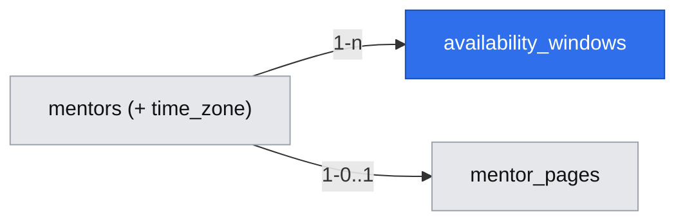

# Mentor weekly availability and open slots

Issue: #15 (E01-S02) · Epic: #8 · Depends on: #14 (spec `2026-10-19-mentor-invitation-and-page-publishing.md`), #23 · Risk: `risk-medium`

## 📝 TLDR

A signed-in mentor (#14) has a page but no way to say when they can take a session, so nothing can be booked. This spec proposes (future behavior) that the mentor sets **weekly windows** in their own time zone ("Tue 18:00–20:00", "Thu 12:00–13:00"), and the system derives 25- and 50-minute slots strictly inside those windows for the next 14 days. Slots are computed, never stored, by one function that the share page (#16) and the request flow (E02) both call — so "only those slots are offered" (R06) has a single source of truth.

## Resolved assumptions (autonomous defaults)

| # | Question | Chosen answer | Rationale | Flag |
|---|---|---|---|---|
| Q1 | Recurring weekly windows or dated one-off windows? | Weekly recurring windows only; no date exceptions in 1.0. | Mentors describe availability as a weekly habit ("między spotkaniami", "nie w weekend"); a staff engineer "forgets it exists" after a month — a set-once pattern keeps the page bookable without upkeep. Date exceptions (vacations) are Later; removing a window works meanwhile. | — |
| Q2 | Slot time zone (open on #15)? | Windows **and the :00/:30 slot grid** are wall-clock times in the mentor's IANA time zone (`mentors.time_zone`, prefilled from the browser, editable). Slots are stored/compared as UTC instants; viewers see them in their own browser zone. | Shared cross-spec decision; correct across DST for the mentor. | — |
| Q3 | Must both lengths be offered (open on #15)? | Every window yields both 25- and 50-minute slots where they fit; no per-window length setting. Follows #14 Q3 (both prices required). | One rule, no extra UI; consistent with #14. | ⚠ NEEDS HUMAN CONFIRMATION (same epic #8 question as #14 Q3) |
| Q4 | Slot grid, horizon and minimum notice? | Local :00/:30 grid; 14-day horizon; `MIN_NOTICE_MINUTES = 180` — **the single constant every spec references** (E02 defines no lead time of its own). Exported constants, not mentor settings. | The grid gives a 25-min session a 5-min buffer; the notice leaves the mentor time to read and accept (R05, R09). It trades against developers' "within the hour" (A01, an assumption the pilot tests by recording the earliest slot offered). | Accepted (shared decision; grill Q3) |
| Q5 | Is there a separate "publish availability" step? | No. Saving windows makes them live immediately; available on draft pages too. | Fewer steps toward the 20-minute target (D08); a page without windows simply offers nothing (AC). | — |
| Q6 | Overlapping windows? | Allowed; the generator merges each local date's windows into disjoint intervals before fitting slots (18:00–19:00 + 19:00–20:00 offers a 50-min slot at 18:30). | Simpler editor than overlap validation; no ambiguity in the result. | — |
| Q7 | Does removing a window cancel existing requests? | No. It only stops future offering. Requests already holding a slot are E02's concern. | No requests exist in this story; keeps the boundary clean. | — |

## 👤 User stories

1. **Mentor sets availability for the first time.** After publishing (#14), Anna opens **Dostępność**. She **sees** her time zone already filled ("Europe/Warsaw") and an empty week. She adds "wtorek 18:00–20:00" and "czwartek 12:00–13:00" from day + start + end pickers (half-hour steps) and saves. The **system** stores the windows and **shows** a preview: "Najbliższe terminy: wt 20.10 18:00 (25/50 min), 18:30 (25/50), 19:00 (25/50), 19:30 (25 min)…". **Next:** her share page (#16) offers exactly those slots.
2. **Mentor stops a window.** Anna's Thursday lunch fills with meetings; she removes it and saves. The **system** stops offering every Thursday slot at once. **Next:** a developer opening her link sees only Tuesdays.
3. **Mentor with no windows.** Piotr published his page but skipped availability. His editor **shows** "Nie masz dostępności — nikt nie może wybrać terminu" with a link to add one; his share page shows no selectable slot (AC).
4. **Developer (through #16 / E02).** A developer in London opens Anna's link on Monday at 19:00 Warsaw time; Tuesday 18:00 Warsaw is offered, shown as 17:00 in his zone; nothing starting within the next 3 hours is ever offered.

## 📝 Problem Statement

R06 ("slots come only from availability the mentor published") and R01 (25/50 minutes) need a model of mentor time before any request can exist (E02 depends on it). Mentors set the constraints: answers "między spotkaniami", "nie pisz do mnie w weekend", and a month of silence means they forget the product (interviews 2026-09-03). The model must be quick to set once and impossible to bypass when a request is created.

## 📝 Proposed Solution

- **Store windows, compute slots.** `availability_windows` holds weekday + start/end minute in the mentor's zone. A pure function `listOpenSlots({ windows, timeZone, now, horizonDays, busy })` in `lib/availability/slots.mjs` returns `[{ startsAt, lengthMinutes }]` (UTC ISO). `busy` is an injected list of intervals that must not be offered — empty in this story; E02 passes intervals held by its requests.
- **Zone conversion** without a new dependency (Temporal is not on Node 20). DST rules: candidates are the local :00/:30 wall times of each local date inside a merged window; each converts to UTC; a wall time inside a spring-forward gap yields no slot; an ambiguous fall-back time takes the first occurrence; a slot must end (start + real elapsed minutes) no later than the window's end converted to UTC.
- **Editor** at `/mentor/availability` behind #14's `getCurrentMentor()`; saving replaces the mentor's whole window set atomically.

Research: Cal.com and Calendly model availability the same way — weekly schedule in a named zone, minimum notice, rolling booking horizon, computed slots — and add date overrides, buffers and per-event durations, which this spec skips (overrides are Later; the :30 grid replaces buffers; lengths are fixed by R01). Storing pre-generated slot rows was rejected: it needs a job to roll the horizon and goes stale when a window changes.

## 📝 Architecture

- New: `lib/availability/slots.mjs` (pure, `node --test`), `lib/availability/zone.mjs`, `lib/availability/queries` (load windows + zone for a mentor), `app/mentor/availability/page.tsx` + server action.
- Consumers: #16 calls `listOpenSlots` at request time for the public page; #17 calls `isSlotOffered` server-side when a request is created (R06 enforced at write, not only at display). `isSlotOffered` is a **pre-check only**: the atomic slot hold against a concurrent request is #17's (mentor row lock in the request transaction). Slot reads are time-dependent: request time, never cached.

## 📝 Data Model

Migration `0004_availability` (next free number at merge time; see #14).

**`mentors`** — new column `time_zone` text null (null until first save); app validates against `Intl.supportedValuesOf('timeZone')`. Not PII; never shown publicly.

**`availability_windows`** (new):

| Column | Type | Rule |
|---|---|---|
| `id` | uuid | PK |
| `mentor_id` | uuid | FK → `mentors.id` on delete cascade; index |
| `weekday` | smallint | CHECK 1–7 (ISO, Monday = 1) |
| `start_minute` | smallint | CHECK 0–1410 and `% 30 = 0` |
| `end_minute` | smallint | CHECK 30–1440, `% 30 = 0`, `end_minute > start_minute` |
| `created_at` | timestamptz | |

Windows do not cross midnight (a late window is split by the mentor into two days). Down migration drops the table and the column.

## 📝 API Contracts

- `listOpenSlots({ windows, timeZone, now, horizonDays = 14, minNoticeMinutes = MIN_NOTICE_MINUTES, busy = [] })` → `[{ startsAt (UTC ISO), lengthMinutes }]` sorted by `startsAt`, then length. Windows of each local date are merged into disjoint intervals; a slot is included when it lies fully inside one merged interval (DST rules above), `start ≥ now + notice`, `start < now + horizon`, and it overlaps no `busy` interval. `busy` is `[]` here; #17 passes its held ranges. No `timeZone` or no windows → `[]`.
- `isSlotOffered({ mentorId, startsAt, lengthMinutes, now, busy })` — loads windows + zone and returns whether that exact slot is in `listOpenSlots` output.
- Exported constants: `MIN_NOTICE_MINUTES = 180`, `SLOT_GRID_MINUTES = 30`, `HORIZON_DAYS = 14`.
- Server action `saveAvailability({ timeZone, windows: [{ weekday, startMinute, endMinute }] })` → `{ ok } | { ok: false, errors }`. Payload guard: at most 21 windows. Mentor from session only.

## 📝 UI/UX

- One screen: time zone select (prefilled from the browser on first visit), seven weekday rows, "+ okno" per day with start/end selects in 30-minute steps (minimum window 30 min, which always fits a 25-min slot), remove (×) per window, Save. After save: the next 10 offered slots as a preview, in the mentor's zone.
- Changing the time zone of a saved set shows an inline warning "Okna zachowają godziny (np. 18:00) w nowej strefie" and the button reads "Zapisz i zmień strefę"; nothing changes until saved.
- Empty state and the editor banner from story 3. Error: an end before start is prevented by the select options; server errors keep the unsaved set on screen.
- `/mentor` (#14) gains a link "Dostępność" and the "no availability" notice.

## 📝 Edge Cases & Failure Scenarios

- DST change inside the horizon: slots follow the mentor's wall clock (an 18:00 window stays 18:00 local); gap/overlap rules above.
- Mentor changes time zone: windows keep their wall-clock meaning in the new zone (warning + explicit save, UI above).
- Window removed while a request holds one of its slots: the request is unaffected (E02); the slot simply stops being offered. If the mentor can no longer take it, they decline it (#18, full refund). `saveAvailability` does not take the mentor row lock that #17 uses for the atomic slot hold.
- Window shorter than 50 minutes (e.g. 12:00–12:30): offers only a 25-minute slot.

## 📝 Risks & Impact Review

- The slot function is a contract E02 builds on. Changing grid, notice or horizon later changes what can be requested — named constants with tests.
- 3-hour notice limits the "within the hour" job (A01); the pilot export records the earliest slot offered (collection plan 1).
- Schema change is additive (`risk-medium` overall; the migration still gets the up/down test per `BACKWARD_COMPATIBILITY.md`). New URL `/mentor/availability` is private (no protected-surface entry needed beyond the schema).

## 📝 Decisions in play

Relies on R01, R06, D02, D08 (setup speed). Leaves open epic #8's both-lengths question (defaulted ⚠, shared with #14). Supersedes nothing. Owner: Krzysztof Marczak.

## 📋 Phasing

Single phase, one PR: the slot engine without the editor offers nothing to anyone, and the editor without the engine has no preview. #16's slot section integrates once this merges.

## 📋 Implementation Plan

1. Migration `0004_availability`: `availability_windows`, `mentors.time_zone`. Test: up → down → up; CHECKs reject `end ≤ start` and off-grid minutes.
2. Zone conversion + `listOpenSlots` + exported constants. Unit tests (fixed `now`): Europe/Warsaw March/October DST Sundays (gap → no slot, overlap → first occurrence) and America/New_York; both lengths inside a 2-hour window; 30-minute window → 25 min only; nothing outside windows (R06); nothing before `now + MIN_NOTICE_MINUTES` or after 14 days; adjacent windows merged (50 min at 18:30); a `busy` interval removes overlapping slots; no windows → `[]` (AC).
3. Window/zone query + `isSlotOffered`. Test: empty for a mentor without windows; exact-match semantics.
4. `saveAvailability` action. Integration tests: round-trip; removing a window removes its slots (AC negative); no session → refused; mentor A cannot write mentor B's windows.
5. `/mentor/availability` page (zone prefill, zone-change warning, preview) and `/mentor` link/notice. Tests: preview from the saved set; no-availability notice (story 3). QA in a real browser incl. narrow viewport (`needs-qa`). PR body lists ⚠ Q3.

## 🔍 Review & grill outcome

GPT review → decisions:
- **Decision needed, 3-h notice vs A01:** accepted as the shared constant `MIN_NOTICE_MINUTES = 180`; A01 is an assumption, measured in the pilot (earliest slot offered), not a rule it overrides.
- **High, grid local vs UTC unspecified:** accepted — local :00/:30 grid in the mentor's zone, stored as UTC; DST candidate rules written once in Proposed Solution.
- **High, windows yielding no 25-min slot:** rejected — CHECKs force 30-minute steps, so the shortest window (30 min) always fits a 25-min slot; noted in UI.
- **High, concurrent writes not atomic:** accepted as a boundary — `isSlotOffered` is a pre-check; the atomic hold is #17's.
- **Medium, time-zone change without confirmation:** accepted — inline warning + explicit "Zapisz i zmień strefę"; a modal diff was cut.
- **Medium, Phase 1 has no usable path:** accepted — merged into a single phase.
- **Medium, split engine into its own spec:** rejected — neither half ships value alone (same reason as the merge).
- **Low, over-detailed implementation:** accepted — helper names and test lists trimmed; DST rules and constants kept (they are the contract).

Grill (`reviews/2026-10-19-mentor-weekly-availability-and-open-slots.grill.md`): 2 rounds, 9 questions; 8 accepted on owner's blanket yes, 1 stays ⚠ (Q3 both lengths).
