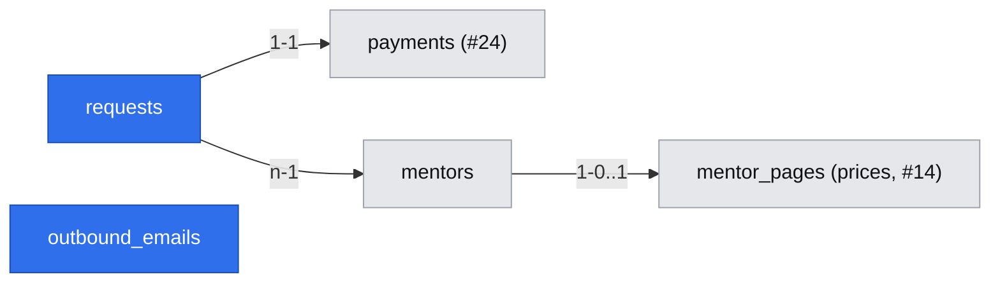

# Prepaid request with the question up front

Issue: #17 (E02-S01) · Epic: #9 · Depends on: #16 (share page), #15 (slots), #24 (spec `2026-10-19-stripe-card-payment-refund-and-webhook.md`) · Risk: `risk-high` (money, new public URL, schema, email)

## 📝 TLDR

A developer who opens a mentor's share link can see prices and slots (#16) but cannot ask anything. This spec proposes (future behavior) that on the same page they pick a length and a slot, write their name and question, pay the mentor's price by card through Stripe Checkout (#24), and land on a private request page that confirms *Opłacone — czeka na mentora* — within 5 minutes, without creating an account. The slot is held atomically from *Pay*; the request reaches the mentor only after the money has arrived, and both sides get a short email. This spec also owns the one email adapter that #18 and #19 reuse.

## Resolved assumptions (autonomous defaults)

> **2026-10-19 — owner confirmation:** Krzysztof Marczak confirmed every ⚠ item in this spec as written (chat: „Potwierdzam wszystkie decyzje ⚠ ze specyfikacji lekcji 05 tak, jak są zapisane”). Remaining ⚠ marks below are historical.

| # | Question | Chosen answer | Rationale | Flag |
|---|---|---|---|---|
| Q1 | Account or guest (brief Key flow step 3)? | **Guest.** Private request link `/r/{token}`; Stripe Checkout collects the email. | 5-minute target, "nie że zakładam konto" (D08); a later account can claim requests by email. | ✅ CONFIRMED by Krzysztof Marczak (2026-10-19) (the brief left this undecided on purpose) |
| Q2 | Notifications? | Minimal transactional emails through **one provider-agnostic adapter** owned here: mentor on a new paid request; developer on payment (with the `/r/` link), accept, decline, lapse, refund done/failed. Address of the developer = Stripe's `payer_email` (no extra form field). | Coordinator decision (A01 risk); a lost link becomes recoverable from the inbox. | — |
| Q3 | Does a pending request hold the slot? | **Yes**, atomically from *Pay* (mentor-row lock); released as soon as Stripe confirms the checkout expired, at the latest `checkout_expires_at + 10 min`. | No double sale; no slot blocked by a dead checkout. | — |
| Q4 | Earliest bookable slot? | `MIN_NOTICE_MINUTES = 180` from #15, applied by `isSlotOffered`. | Single constant (coordinator decision). | ⚠ via #15 (3 h vs A01) |
| Q5 | What does the mentor see about who is asking? | Typed name (2–80 chars) + question. Payer email never shown to the mentor. | D02 without exposing contact data (R04). | — |
| Q6 | Question limits? | 20–4000 chars after trim, plain text rendered as text. Hint: what you tried, the error, the deadline; no secrets. | AC (empty refused); 4000 fits a stack trace. | — |
| Q7 | Slot and price model? | #15 `listOpenSlots` / `isSlotOffered` (mentor-local :00/:30 grid, UTC storage, 14-day horizon), #16 per-slot links, #14 `price_25_minor`, `price_50_minor`, `currency` (both lengths required). E02 passes `busy` = held ranges. | One source of truth (R06, R07). | ⚠ via #14 (Q02 currency) |

## 📝 Problem Statement

Developers stuck before a deadline wait a median 67 minutes on Discord, and 23 of 109 threads got no reply (`[DATA]`); three of four interviewed developers shipped a workaround, rolled back or under-quoted (`[INTERVIEW]`). D02 and D04 answer with a prepaid question to a mentor reached through the mentor's own link. If paying takes longer than 5 minutes ("robię rollback i idę do domu", D08), or a mentor receives unpaid or duplicate requests, both sides walk away.

## 👤 User stories

1. **Developer sends a request.** Kuba has a server-components question, deadline tomorrow. On Anna's link he **sees** 25 min — 150 zł, 50 min — 280 zł and open slots, and **wants** to ask without signing up. He picks *25 min*, tomorrow 12:30, types his name and pastes the question. The button **reads** *Zapłać 150 zł i wyślij pytanie*. The **system** checks the slot and price, holds the slot, creates the request and a pending payment, and redirects to Stripe. He pays and returns to `/r/…`: *Opłacone — czeka na mentora*, his question, the slot in his time zone, the amount, and *Zapisz ten link — wysłaliśmy go też na Twój e-mail* with *Kopiuj link*. Minutes later the email arrives. **Next:** Anna gets an email and decides (#18); Kuba can cancel until then (#19).
2. **Developer abandons payment.** On Stripe's page Kuba clicks back. The **system** asks Stripe to expire the checkout; nothing is charged, the slot is released, and `/r/…` **shows** *Płatność przerwana — nic nie pobrano* with the question in a copyable box and *Wybierz inny termin*. If he closes the tab, the same happens when the checkout expires (≤ ~35 min).
3. **Two developers want one slot.** Ola presses *Pay* a second after Kuba and **sees** *Ten termin właśnie się zajął — wybierz inny*, her question kept, the slot list refreshed. Nobody is charged twice.
4. **Mentor's side.** Anna never sees an unpaid or abandoned request. Once paid she gets *Nowe opłacone pytanie od Kuby — 25 min, jutro 12:30; zdecyduj przed 12:30* with a link to `/mentor/requests/{id}` (#18).

## 📝 Proposed Solution

- **Form + action.** The form lives on `/m/{slug}` (#16) below prices and slots; server action `startRequest`. Shown price and slot are posted as `expectedAmountMinor`, `slotStart`; the server recomputes both and refuses on mismatch.
- **Atomic hold (one transaction):** `SELECT … FOR UPDATE` on the `mentors` row → page published → `isSlotOffered` (#15) with `busy = heldRanges(mentor)` → `createPayment(tx, …)` (#24) → insert request `awaiting_payment` → insert the developer's confirmation email as a `draft` (recipient unknown until Stripe). After commit: `openCheckout` (`successUrl = /r/{token}?checkout=return&session_id={CHECKOUT_SESSION_ID}`, `cancelUrl = /r/{token}?checkout=cancel`); redirect. The mentor-row lock serializes every hold for one mentor, so the overlap check cannot race.
- **Hold rule.** A request holds its slot when `awaiting_mentor` or `accepted`, or `awaiting_payment` while its payment is `pending` and `now() < checkout_expires_at + 10 min`. #24 writes `expired` only once Stripe confirms the session cannot be paid, and its reconciliation runs at `checkout_expires_at + 1 min`, so the grace is a safety net, not the normal path.
- **Payment subscriber** (#24 Q8, inside the payment transaction, takes the mentor-row lock):
  - `payment.succeeded`: request `awaiting_payment` and no **other** holding request overlaps → `awaiting_mentor`, `paid_at`; confirmation email set to `payer_email` and due; mentor email due. Otherwise (request already `payment_failed`, or its slot was re-held after the grace) → stays/becomes `payment_failed`, `requestRefund(tx, …, 'invalid_on_payment')`, late-payment email. Deterministic: a paid slot is never double-booked.
  - `payment.expired` → `payment_failed`; draft email deleted; hold released.
  - `refund.succeeded` / `refund.failed` → developer email (covers #18, #19, late payment).
- **Return / cancel.** `/r/{token}` calls `syncCheckout(paymentId, sessionId)` on `checkout=return` and `expireCheckout(paymentId)` on `checkout=cancel`. Stripe is the authority: if the mentee actually paid, cancel ends in *Opłacone*.
- **Availability edits.** A request is validated against availability once, at creation (R06). Removing a window later never cancels a held or paid request; the mentor can decline it (#18).
- **Email adapter** `lib/email`: `enqueueEmail(tx, { to, template, params })` writes an outbox row in the caller's transaction; after commit the caller may `sendDue(ids)`; the jobs endpoint (#24) runs `email.sendDue` for the rest (claim with a lease like #24 refunds; a rare duplicate email is acceptable, a lost one is not). Transports: `log` (dev, tests capture in memory) and `smtp` via `nodemailer` (`SMTP_URL`, `EMAIL_FROM`) — any provider. Plain-text Polish templates; **no question text** in any email. #14 may reuse `enqueueEmail` for mentor sign-in links.

Rejected: an exclusion constraint on `tstzrange` (needs `btree_gist`; the foundation avoids extensions; the mentor-row lock gives the same guarantee); creating the request only after payment (slot sold twice during checkout; question through Stripe metadata breaks R04); a developer email field on our form (one more field against D08; Stripe already asks).

## 📝 Data Model

Migration `0006_requests` (after #24's 0005). It defines the **whole request state machine** for E02 as an explicit cross-spec contract, so #18 and #19 add transitions, not CHECK-replacing migrations:

| Transition | Owner |
|---|---|
| (new) → `awaiting_payment` → `awaiting_mentor` \| `payment_failed` | #17 |
| `awaiting_mentor` → `accepted` \| `declined` \| `lapsed` | #18 |
| `awaiting_mentor` → `cancelled` | #19 |

**`requests`**

| Column | Type | Rule |
|---|---|---|
| `id` | uuid | PK; also the session id #20 uses |
| `mentor_id` | uuid | FK → `mentors.id` `on delete restrict` |
| `payment_id` | uuid | FK → `payments.id`, unique, not null |
| `status` | text | the seven states above |
| `length_minutes` | integer | CHECK in (25, 50) (R01) |
| `slot_start`, `slot_end` | timestamptz | CHECK `slot_end = slot_start + length_minutes * interval '1 minute'` |
| `mentee_name` | text | 2–80 chars |
| `question` | text | 20–4000 chars after trim (R05) |
| `access_token_hash` | text | unique, SHA-256 of the `/r/{token}` token |
| `submission_id` | uuid | unique; generated in the browser per attempt |
| `paid_at`, `accepted_at`, `declined_at`, `lapsed_at`, `cancelled_at` | timestamptz | null; set by the owning transition |
| `created_at`, `updated_at` | timestamptz | |

Index `(mentor_id, slot_start) WHERE status IN ('awaiting_payment','awaiting_mentor','accepted')`. Amount and currency live only on `payments`.

**`outbound_emails`**: `id` uuid PK · `to_address` text null (null only while `draft`) · `template` text · `params` jsonb null · `status` `draft` \| `due` \| `sent` \| `failed` · `attempts` int · `next_attempt_at`, `lease_until`, `sent_at` timestamptz · `last_error` text (provider code only) · `created_at`. **`params` is set to null once sent or failed** — the confirmation email carries the plaintext `/r/` link, which therefore lives in the database only until it is sent (minutes). Retries with backoff for 24 h, then `failed` + log.

**Token contract (`/r/{token}`):** 32 random bytes (`crypto.randomBytes`), base64url; only the SHA-256 hash stored; not single-use (it is the developer's view/cancel credential); valid until 30 days after `slot_end`, then 404; not rotatable in 1.0. Every `/r/` read and action resolves the request from the token hash only — no request id in forms.

Down migration drops both tables (dev/test only; forward-fix after pilot data exists).

## 📝 API Contracts

- **`startRequest({ slug, submissionId, lengthMinutes, slotStart, expectedAmountMinor, menteeName, question })`** → redirect to Stripe, or `{ ok: false, errors }`: `field`, `slot_taken`, `slot_not_offered`, `price_changed` (with new price), `page_unavailable`, `payments_unavailable`, `checkout_failed` (`retryable` flag). Input always echoed back. A repeated `submissionId` whose request is still `awaiting_payment` with a `pending` payment and identical slot/length/amount → `openCheckout` again for **that** payment (stored URL, or recovery with #24's same key) — so a retry after a timeout never blocks the developer with their own hold. Any other repeat is refused and the browser makes a new id; after a non-retryable failure the old request is already `payment_failed` and its slot free.
- **Page `/r/{token}`** — new public URL (protected surface; `BACKWARD_COMPATIBILITY.md`). Unknown or expired token → 404, no detail. `Referrer-Policy: no-referrer`, `robots: noindex`. Dynamic.
- **`lib/requests`**: `heldRanges(mentorId, from, to)`, `getRequestByToken(token)`, status constants, the payment subscriber. **`lib/email`**: `enqueueEmail`, `sendDue`, templates.

## 📝 UI/UX

> copy neutralized per design system Content rule C12, 2026-10-19 — UI copy uses gender-neutral forms (e.g. „Pytanie zostało właśnie zaakceptowane”, „Brak odpowiedzi mentora przed terminem”, „kopia jest też w e-mailu z potwierdzeniem”); see `docs/design-system.md` and Storybook › Content.

- Form order: length → slot (minus held ranges) → name → question → pay button with the exact amount. Two typed fields. Button disabled while submitting.
- `/r/{token}` states: *Czekamy na potwierdzenie płatności* (auto-refresh every 3 s for 1 min, then a refresh button and *nic nie zostanie pobrane dwa razy*) · *Opłacone — czeka na mentora* · *Płatność przerwana — nic nie pobrano* · *Płatność dotarła za późno — zwrot zlecony*. #18 and #19 add theirs.
- Times in the viewer's zone with its name; stored UTC.
- Errors inline, `aria-live`, focus on the first error; the save-the-link box is main content.

## 📝 Edge Cases & Failure Scenarios

| Scenario | Developer sees | System |
|---|---|---|
| Empty or 1-word question | Field error (AC, R05) | No rows |
| Price changed after page load | *Cena zmieniła się na 180 zł* + confirm again | No hold, no payment |
| Slot taken / not offered | Specific message, list refreshed, input kept | Rolled back |
| Double click / resubmit | Same Stripe page | `submission_id` unique |
| Stripe timeout opening checkout | *Nie udało się otworzyć płatności — spróbuj ponownie*; retry uses the same request | Payment stays `pending`; #24 recovers or expires it |
| Stripe definitive error | Same message; new attempt possible at once | `payment_failed`, hold released |
| Card declined | Stripe shows it; retry there until expiry | No change |
| Tab closed on Stripe | — | #24 expires via Stripe → `payment_failed`, hold released |
| Cancel clicked but payment completed a moment earlier | *Opłacone — czeka na mentora* | `expireCheckout` gets *complete* from Stripe → `succeeded` |
| Payment confirmed after `payment_failed`, or slot re-held after the grace | *Płatność dotarła za późno — zwrot zlecony* + email | `requestRefund(…, 'invalid_on_payment')` |
| Mentor removed the window or unpublished during checkout | Payment succeeds normally | Request stays valid; mentor may decline (#18) |
| Email provider down | — | Outbox retries 24 h; then `failed` + log |
| Lost `/r/` link | Find it in the confirmation email | — |

## 📝 Risks & Impact Review

- **SDLC gates:** money (failure, retry, idempotency tests), schema (up/down, rollback plan), new public URL `/r/{token}`, subscriber contract, new outbound channel (email). Second reviewer; `needs-qa`, no self-QA.
- **Sensitive data:** questions may contain employer code (A08); stored plaintext, visible only to the two parties (R04), never emailed, sent to Stripe or logged. Emails carry names, slot times and the developer's link; legal ownership of personal data and email processing is Q04 (blocks real users, not the build). The link token appears in Stripe's success URL and transiently in `outbound_emails.params` — acceptable: it grants only this request's view and a refund to the same card.
- **Product calls:** Q1 (⚠), Q4 and Q7 via E01 specs.

## 📝 Decisions in play

Relies on D02 / R05, R06, D04 / R07, R08, D08, R04, R01. Open: Q01, Q02, Q04, Q05 (live payments, real users). Supersedes nothing. Owner: Krzysztof Marczak.

## 📋 Phasing

Single phase: form, hold, payment link and notifications only make sense together.

## 📋 Implementation Plan

1. **Migration `0006_requests`** (`requests`, `outbound_emails`). Test: up/down/up; CHECKs reject length 30, empty question, mismatched `slot_end`, duplicate `payment_id`, unknown status.
2. **`lib/requests/validate.mjs`** (pure). Unit tests incl. whitespace-only question refused (AC negative).
3. **Held ranges.** DB tests: slot held by `awaiting_mentor`, `accepted`, `awaiting_payment` with pending payment is not offered; reappears after `payment_failed` and after `checkout_expires_at + 10 min`.
4. **`startRequest`** (fake Stripe). DB tests: payment amount equals page price for the length (AC); `price_changed`; overlap → `slot_taken`; two concurrent starts on two connections → exactly one succeeds; repeated `submissionId` → same checkout, one request; retry after a retryable failure reuses the request; slot outside availability or inside the notice → `slot_not_offered`.
5. **Payment subscriber.** Tests: success → `awaiting_mentor` + `paid_at` + mentor and developer emails due (developer to `payer_email`); expired → `payment_failed`, draft deleted; success after `payment_failed` or onto a re-held slot → refund `invalid_on_payment`, no double booking; subscriber failure rolls back the payment transition.
6. **`lib/email`.** Tests: outbox row written in the caller's tx and rolled back with it; `sendDue` sends once and nulls `params`; transport failure → retry, then `failed` after 24 h; no template contains the question text.
7. **Form on `/m/{slug}`.** Tests: field order, amount on the button, each error code renders with input preserved, focus on first error.
8. **`/r/{token}`.** Tests: unknown/expired token → 404; foreign `session_id` ignored; cancel → `payment_failed`, nothing charged, no mentor visibility (AC negative); cancel after Stripe completion → *Opłacone*; each state renders.
9. **Docs and QA.** `BACKWARD_COMPATIBILITY.md`: `/r/{token}`; README/.env: `SMTP_URL`, `EMAIL_FROM`. PR body: rollback plan, ⚠ Q1. QA in a real browser with Stripe test cards (abandon path, two tabs racing for one slot, emails in the log transport) incl. a timed first-time walkthrough ≤ 5 min (D08, AC).

## 🔍 Review & grill outcome

GPT review → grill log `reviews/2026-10-19-prepaid-request-with-question.grill.md`.

| GPT finding | Outcome | Why |
|---|---|---|
| Decision: guest access (Q1) | **Kept ⚠** | Brief leaves it to the owner on purpose; guest stays the build default. |
| Decision: notifications (Q2) | **Accepted** | Coordinator decision: minimal emails via one adapter owned here; link also emailed. |
| High: cancel return vs completed payment | **Accepted** | Stripe is the authority (`expireCheckout` returns *complete* → paid). |
| High: hold expiry vs late payment | **Accepted** | Hold ends on Stripe-confirmed expiry (grace +10 min); late success re-checks overlap under the mentor lock, else refund. |
| High: token contract undefined | **Accepted** | 256-bit token, hashed, 30 days after slot, resolved by hash only. |
| Medium: retry after expiry | **Accepted** | Same `submissionId` reuses the same pending payment; definitive failures free the slot at once. |
| Medium: availability edits vs lock | **Accepted (by definition)** | Validated once at creation; later edits never cancel a request. |
| Medium: later-story states in this migration | **Rejected** | Kept as an explicit cross-spec contract with a transition-owner table; avoids CHECK-replacing migrations in #18/#19. |

Grill decisions (11 questions, 1 ⚠ — Q1 guest vs account): email adapter + outbox; developer address from Stripe; no question text in email; link-carrying draft email with params wiped after send; Stripe-confirmed hold release with 10-min grace; overlap re-check on late success; token contract; same-id retry; availability edits don't touch requests; state-machine contract; cancel-return resolved by Stripe.
