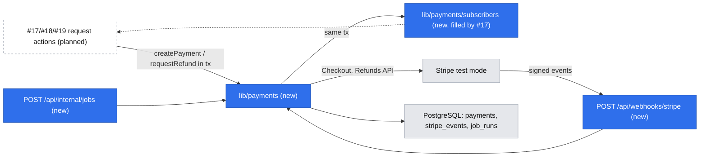

# Stripe card payment, refund operation and payment webhook

Issue: #24 (E02-S01-T01) · Story: #17 · Epic: #9 · Risk: `risk-high` (money, shared contract: webhook) · Reused by: #17, #18, #19, later #21, #22

## 📝 TLDR

Every money movement in E02/E03 (pay for a request, refund on decline, lapse, cancel, mentor no-show) needs one trustworthy payment primitive; today there is none. This spec proposes (future behavior) a `lib/payments` module on Stripe **test mode only**: hosted Stripe Checkout for the card charge, one idempotent full-refund operation persisted in the caller's transaction and executed after commit under a durable lease, a signed and replay-safe webhook, and a scheduled reconciliation job. It knows nothing about requests; stories plug in through a payment-event subscriber.

## Resolved assumptions (autonomous defaults)

| # | Question | Chosen answer | Rationale | Flag |
|---|---|---|---|---|
| Q1 | Hosted Checkout or embedded Payment Element? | Hosted **Stripe Checkout** (`mode: payment`, card only), redirect and return. | Least UI and PCI surface, 3-D Secure and card errors handled by Stripe, fits the 5-minute target (D08). | — |
| Q2 | Capture at payment, or authorize and capture on mentor accept? | **Capture immediately**; every "money back" path is a full refund. | R08 (pay when sending); authorizations expire in ~7 days; #21 needs a refund after capture anyway. | — |
| Q3 | Commission (Q01 open)? | Env `PLATFORM_COMMISSION_BPS`, **snapshotted** on each payment; unused by E02; payouts (#22/#25) read the snapshot. `.env.example`: `1000`. | The mentee always pays the full price; a snapshot keeps later payouts correct. | ⚠ NEEDS HUMAN CONFIRMATION (Q01 rate) |
| Q4 | Currency (Q02 open)? | The caller passes the mentor page's `mentor_pages.currency` (#14, default `PLN`); `PAYMENT_CURRENCIES` (`.env.example`: `PLN`) is only an allowlist. Stored uppercase, lowercased for Stripe. | One source (the page); env only blocks a currency Stripe/test setup is not ready for. | ⚠ NEEDS HUMAN CONFIRMATION (Q02) |
| Q5 | Live keys? | **Refused.** `STRIPE_SECRET_KEY` must start with `sk_test_`/`rk_test_`; `livemode: true` events rejected. Going live is a later spec after Q01, Q02, Q04, Q05. | A config flag alone is too easy to flip. | — |
| Q6 | Who pays Stripe fees on refunds? | The platform; the mentee always gets the full amount (R09, R11). | R09/R11 say "full refund". | ⚠ NEEDS HUMAN CONFIRMATION (Q01/Q05 before live) |
| Q7 | Disputes / chargebacks? | Recorded only (`disputed_at`, log); handled in the Stripe dashboard. | No dispute owner (Q05). | ⚠ NEEDS HUMAN CONFIRMATION (Q05 owner) |
| Q8 | How do stories learn about payment outcomes? | Explicit subscriber list in `lib/payments/subscribers`, called **inside the same DB transaction** as the transition. No queue, no bus. | One process, one DB. | — |
| Q9 | Who runs scheduled work? | `POST /api/internal/jobs` with `Bearer $CRON_SECRET`, called every 5 min by whatever cron the host offers (chosen with hosting, foundation spec Q8); locally `npm run jobs` every 60 s. | Scheduler-agnostic. | — |
| Q10 | Refund failing for 24 h? | Terminal `failed`, error log, counted in the jobs health endpoint so a monitor alerts; fixed by hand in the Stripe dashboard. | Automatic retries beyond 24 h hide a real problem; manual handling needs an owner. | ⚠ NEEDS HUMAN CONFIRMATION (Q05 owner) |

## 📝 Problem Statement

R08 (prepaid by card), R09 (automatic same-day refund, no ticket) and R11 (refund on cancel) are only as good as the payment primitive under them. A request must never reach a mentor unless money really arrived, and money must never be refunded twice or silently not at all. Stripe talks to us asynchronously, retries, and can deliver events late, twice or out of order; our server can crash or time out between "Stripe said yes" and "we wrote it down". SDLC's money gate requires tested failure, retry and idempotency paths and a second reviewer.

## 📝 User stories (served through the consuming stories)

1. **Mentee paying (#17).** A developer has written the question and clicked *Pay*. They see Stripe's card page with the mentor's price, pay, and land on their request page: *Opłacone — czeka na mentora* (UI copy is Polish, as in #14). The system marks the payment succeeded from whichever arrives first — return redirect or webhook — exactly once. If they close the tab or the card fails, nothing is charged and the slot frees once Stripe confirms the checkout expired (≤ ~35 min).
2. **Mentee getting money back (#18, #19, #21).** The mentor declined, the slot started unanswered, or the mentee cancelled. The mentee sees *Zwrot zlecony* the same day without asking anyone. The system records the refund intent atomically with the reason, issues at most one Stripe refund per payment however often it is asked, and keeps retrying in the background if Stripe is down.

## 📝 Proposed Solution

- **Charge = two steps.** `createPayment(tx, …)` inserts a `pending` payment inside the caller's transaction. After commit, `openCheckout(paymentId, …)` creates the Checkout Session (idempotency key `checkout:<paymentId>`, `expires_at` = now + 30 min, `metadata.payment_id`) and returns the URL. Nothing about the request goes to Stripe.
- **Stripe decides terminal states.** `pending → succeeded` comes from `checkout.session.completed` (`payment_status = paid`) or `syncCheckout` on the return page. `pending → expired` is written **only after Stripe confirms** the session cannot be paid: a `checkout.session.expired` event, a retrieve showing `expired`, or our own `checkout.sessions.expire` call. Both transitions are guarded `WHERE status = 'pending'`; subscribers run only for the caller that won.
- **Refund = outbox + lease.** `requestRefund(tx, paymentId, reason)` sets `refund_status = 'requested'` in the caller's transaction (no-op if already set). After commit the caller *may* call `executeRefund(paymentId)` for speed; the retry job owns every due `requested` row, so refunds requested inside a webhook transaction or lost to a crash still run.
- **Never two refunds** (resolves the review's critical finding — a row lock cannot span an HTTP call):
  1. **Claim, committed before Stripe is called:** `UPDATE payments SET refund_attempts = refund_attempts + 1, refund_lease_until = now() + 5 min WHERE id = $1 AND refund_status = 'requested' AND refund_next_attempt_at <= now() AND (refund_lease_until IS NULL OR refund_lease_until < now()) RETURNING refund_attempts`. Zero rows → someone else owns it; return.
  2. **Adopt before create:** list the PaymentIntent's refunds; any not `failed`/`canceled` is adopted, no create.
  3. **Create:** `refunds.create({ payment_intent }, { idempotencyKey: 'refund:<paymentId>:<attempt>' })`. The SDK's network retries (`maxNetworkRetries: 2`, 20 s timeout — total well under the lease) reuse that key, so a timeout inside an attempt never creates a second refund; a new attempt gets a new key so a cached Stripe error is not replayed.
  4. **Write result** guarded `WHERE refund_attempts = $attempt AND refund_status = 'requested'`, clearing the lease. A worker whose lease expired writes nothing.
  5. **Backstop:** every refund is the full amount, and Stripe refuses a refund beyond the charge's remaining amount (`charge_already_refunded` → adopt as success). Even two overlapping attempts cannot move money twice.
- **Reconciliation job:** pending payments past `checkout_expires_at` + 1 min → `expireCheckout` (Stripe answers *expired* or *complete*; we apply that); `pending` refunds older than 1 h → retrieve the refund and apply its status.

Rejected: Payment Element (more UI, same backend); manual capture (Q2); a generic event bus or queue (Q8); a stable single refund key (Stripe would replay a cached error forever).

## 📝 Architecture

Takeaway: stories call `lib/payments`; Stripe calls the webhook; both converge on the same guarded transitions, and stories hear back through in-transaction subscribers.

- **Stripe client** injected (`getStripe()`; a fake in tests). New dependency: `stripe` (pinned).
- **Webhook route** reads the raw body (`await request.text()`), verifies `Stripe-Signature` (SDK default 300 s tolerance), rejects `livemode`, then processes in one DB transaction that first inserts the event id. Dynamic route, no caching.
- **Jobs route** runs `payments.reconcilePending`, `payments.retryRefunds`, then jobs later stories register (#17 `email.sendDue`, #18 `requests.lapseOverdue`). Each job is idempotent, batches of 50, 25 s time budget.
- **Env (README + `.env.example`):** `STRIPE_SECRET_KEY`, `STRIPE_WEBHOOK_SECRET`, `PAYMENT_CURRENCIES`, `PLATFORM_COMMISSION_BPS`, `CRON_SECRET` (≥ 32 chars, else jobs answer 503; rotate by changing env on host and scheduler together). Never `NEXT_PUBLIC_`. Missing or live key → typed `PaymentsUnavailable`; webhook and jobs answer 503.

## 📝 Data Model

Migration `0005_payments` (after #14's 0002–0003 and #15's 0004). Foundation conventions (uuid PKs, `timestamptz`, app-set `updated_at`).

**`payments`** — one card charge and its single full refund.

| Column | Type | Rule |
|---|---|---|
| `id` | uuid | PK |
| `status` | text | `pending` \| `succeeded` \| `expired` |
| `amount_minor` | integer | > 0 |
| `currency` | text | CHECK `^[A-Z]{3}$` |
| `commission_bps` | integer | 0–10000, snapshot |
| `stripe_checkout_session_id` | text | unique, null until `openCheckout` |
| `stripe_checkout_url` | text | null; lets a repeated submit (#17) reuse the open session |
| `stripe_payment_intent_id` | text | unique, null until succeeded |
| `checkout_expires_at` | timestamptz | not null |
| `payer_email` | text | null; from Checkout; PII, never shown to mentors; used by #17 for developer emails |
| `succeeded_at`, `expired_at` | timestamptz | |
| `refund_status` | text | null \| `requested` \| `pending` \| `succeeded` \| `failed` |
| `refund_reason` | text | null; `mentor_declined`, `lapsed`, `mentee_cancelled`, `invalid_on_payment`, `external`, later `mentor_no_show` |
| `stripe_refund_id` | text | unique, null |
| `refund_requested_at`, `refunded_at` | timestamptz | |
| `refund_attempts` | integer | default 0; bumped by each claim |
| `refund_lease_until` | timestamptz | null; set by the claim, cleared by the result write |
| `refund_next_attempt_at` | timestamptz | null |
| `refund_last_error` | text | null; Stripe error **code** + Stripe request id only — never the message (may echo input) |
| `disputed_at` | timestamptz | null (Q7) |
| `created_at`, `updated_at` | timestamptz | |

Forward-only guarded transitions: payment `pending → succeeded | expired`; refund `null → requested → pending | succeeded | failed`, `pending → succeeded | failed`; `succeeded`/`failed` terminal. CHECKs: `refund_status is null or status = 'succeeded'`; `(status = 'succeeded') = (succeeded_at is not null)`. Partial indexes for the two jobs (`refund_status in ('requested','pending')`, `status = 'pending'`).

**`stripe_events`** — `event_id text PK`, `type`, `received_at`; a row exists only if processing committed. **`job_runs`** — `name text PK`, `last_run_at`, `last_error text null`.

No FK to requests (requests reference payments, #17). Down migration drops the three tables (dev/test only; forward-fix after pilot data exists).

## 📝 API Contracts

**Module `lib/payments`** (server-only):

| Function | Contract |
|---|---|
| `createPayment(tx, { amountMinor, currency })` → `paymentId` | Currency ∈ `PAYMENT_CURRENCIES` and ≥ Stripe minimum, else `InvalidAmount`; inserts `pending`, `checkout_expires_at = now() + 30 min`. |
| `openCheckout(paymentId, { successUrl, cancelUrl, productName })` → `{ url }` | Stored URL on a pending, unexpired payment → returned without Stripe. Otherwise create with key `checkout:<paymentId>`. **Definitive** Stripe error (4xx other than 409/429) → `expired` via the normal transition + `CheckoutFailed{ retryable: false }`. **Ambiguous** (timeout, network, 5xx, 409, 429) → payment stays `pending`, `CheckoutFailed{ retryable: true }`; a retry reuses the same key and so recovers a session Stripe already created. |
| `syncCheckout(paymentId, sessionId)` → payment | Applies Stripe's answer only if `sessionId` equals the stored session id **and** the session's `metadata.payment_id`, `amount_total` and `currency` match; otherwise ignored (logged). Used by the return page. |
| `expireCheckout(paymentId)` | No session stored → recreate with key `checkout:<paymentId>` (returns any session Stripe made), then expire. Stripe *expired* → `expired`; *complete* → `succeeded`. Used by the cancel URL and reconciliation. |
| `requestRefund(tx, paymentId, reason)` → `'requested' \| 'already'` | Only on `succeeded`; no-op if `refund_status` is set; sets `refund_next_attempt_at = now()`. |
| `executeRefund(paymentId)` | Claim → adopt → create → guarded write (Proposed Solution). Stripe `succeeded`/`pending` mapped; failure → stays `requested`, backoff 1, 5, 15, 60 min then hourly; after 24 h → `failed`. Disputed payment → `failed` at once, `refund_last_error = 'disputed'`, no Stripe call. |
| Subscriber events | `payment.succeeded`, `payment.expired`, `refund.succeeded`, `refund.failed`, each `(tx, { paymentId, … })`; a throwing subscriber rolls back the transition (webhook → 500, Stripe redelivers). |

**`POST /api/webhooks/stripe`** — public contract (moves "Webhooki płatności" to "dziś" in `BACKWARD_COMPATIBILITY.md`). Handled: `checkout.session.completed`, `checkout.session.expired`, `charge.refunded`, `refund.updated`, `refund.failed`, `charge.dispute.created`; others → 200 ignored. **Correlation:** checkout events by stored session id + `metadata.payment_id`, with amount/currency check; refund and charge events by `payment_intent` → `payments.stripe_payment_intent_id`, then by refund id. Unknown or mismatching object → logged, 200, no change (redelivery would not fix it). `charge.refunded` finalizes only when `amount_refunded` equals the payment amount; a partial or multi-refund state from the dashboard → logged warning, no transition (manual, Q05).

| Case | Response |
|---|---|
| Bad or missing signature, stale timestamp | 400, nothing written |
| `livemode: true` | 400, logged |
| Event id already in `stripe_events` | 200, nothing re-run |
| Processed / unknown object | 200 |
| DB / subscriber error | 500 (rollback; Stripe retries) |

**`POST /api/internal/jobs`** — owned here; `Bearer <CRON_SECRET>` compared in constant time; 401 otherwise; 200 with per-job counts. **`GET /api/internal/jobs`** (same auth) → `job_runs` plus `stale: true` when any run is older than 30 min and `failedRefunds: n` — the uptime-monitor target, because a stopped scheduler or a stuck refund silently breaks R09.

## 📝 Edge Cases & Failure Scenarios

| Scenario | Handling | Who sees what |
|---|---|---|
| Webhook and return page both report success | Guard `WHERE status = 'pending'`; second is a no-op | *Opłacone* once |
| Same event twice / replayed | `stripe_events` PK; signature tolerance | — |
| `expired` after `completed` | Terminal states never change | — |
| Mentee pays seconds before expiry while we expire | Our `expire` call loses to Stripe's completion and returns *complete* → `succeeded` | *Opłacone* |
| Checkout create timed out but Stripe made the session | Payment stays `pending`; retry or reconciliation reuses `checkout:<id>` and finds it | *Spróbuj ponownie* (same payment) |
| Return URL with a foreign `session_id` | `syncCheckout` ignores it | Page shows its own state |
| Webhook down or secret wrong | Stripe retries; return page syncs; reconciliation expires/finalizes | *Opłacone* via return page |
| Crash after Stripe refund, before DB write | Lease expires; next attempt adopts the existing refund | *Zwrot w toku* until finalized |
| Slow worker past its lease, second worker starts | Second adopts or Stripe refuses the over-refund; the slow worker's write is ignored (attempt mismatch) | — |
| Refund stays `pending` at Stripe, no webhook | Hourly retrieve applies the final state | *Zwrot w toku* |
| Refund issued by hand (full amount) | `charge.refunded` → `succeeded`, reason `external`, warning | Request page shows the refund |
| Partial/multiple refunds by hand | Logged, no transition (Q05) | Unchanged |
| Disputed charge | No Stripe refund; `failed`, logged | *Zwrot nie powiódł się — napisz do nas* |
| Refund fails for 24 h | `failed`, counted in health, logged | *Zwrot nie powiódł się — napisz do nas* (⚠ Q05 owner) |
| Late success for something no longer valid | Subscriber decides; #17 requests a refund `invalid_on_payment` | Automatic refund |
| Live key / missing config | `PaymentsUnavailable`; webhook/jobs 503 | *Płatności są chwilowo niedostępne* |

## 📝 Risks & Impact Review

- **Hard to reverse:** webhook URL and event set (Stripe dashboard; protected surface), the `payments` shape the pilot export and payouts read, capture-now (Q2).
- **SDLC money + contract gate:** failure, retry, idempotency and concurrency tests; second reviewer; `needs-qa`, no self-QA. Rollback: disable the endpoint in the Stripe test dashboard, revert, `db:rollback` while only test data exists.
- **Sensitive data:** no card data on our server; `payer_email` is the only PII; no request text to Stripe; secrets never logged (log Stripe request ids only); Stripe error messages not stored.
- **Product calls:** Q3, Q4, Q6, Q7, Q10.

## 📝 Decisions in play

Relies on D04 / R08, D05 / R09, R11, D11 / R15 (reused by #21), D07 / R13 (no payout data here). Open: Q01, Q02, Q04, Q05 — they block live payments, not this build. Supersedes nothing. Owner: Krzysztof Marczak.

## 📋 Phasing

- **Phase 1 — Charge and webhook:** schema, test-mode guard, `createPayment` / `openCheckout` / `syncCheckout` / `expireCheckout`, webhook with dedupe and correlation, subscriber list, reconciliation, jobs endpoint and health. QA end-to-end through #17's form.
- **Phase 2 — Refund operation:** `requestRefund` / `executeRefund` with lease, refund webhooks, retry and pending-refund polling, dispute recording.

## 📋 Implementation Plan

**Phase 1**

1. **Config and guard.** `stripe` dependency; `lib/payments/config` validates the five env vars (live key, currency allowlist, bps range, `CRON_SECRET` length); `.env.example` + README. Test: each invalid config → `PaymentsUnavailable` / 503.
2. **Migration `0005_payments`.** Test: up/down/up; CHECKs reject a refund on a non-succeeded payment and `succeeded` without `succeeded_at`.
3. **Charge functions** (fake Stripe). Tests: no request text sent to Stripe; repeated `openCheckout` on an open payment → no second Stripe call; definitive error → `expired` + subscriber; timeout → still `pending`, retry recovers the same session; `syncCheckout` with a foreign session id or mismatched amount → no change; `syncCheckout` twice → one transition; `expireCheckout` on a session Stripe reports complete → `succeeded`.
4. **Webhook route** (payloads signed with `generateTestHeaderString`). Tests: bad signature → 400, no rows; duplicate event → processed once; `expired` after `completed` → no-op; `livemode` → 400; unknown payment → 200, no change; subscriber throws → 500, no `stripe_events` row.
5. **Jobs endpoint, health, reconciliation, `npm run jobs`.** Tests: bad bearer → 401; overdue pending payment expired via Stripe (or succeeded if Stripe says complete); `stale` after 30 min. BACKWARD_COMPATIBILITY: webhook row to "dziś"; npm script `jobs`.

**Phase 2**

6. **Refund outbox and lease.** Tests (money guarantees): two `requestRefund` → one refund; Stripe 500 then success → `succeeded` on attempt 2 with a new key; crash after Stripe success → next attempt adopts, no second create; two workers on two connections → one Stripe create; a worker whose lease expired cannot overwrite the newer attempt; `charge_already_refunded` → `succeeded`; refund requested inside a webhook transaction is executed by the next job run; Stripe `pending` refund finalized by polling; 24 h of failures → `failed` + `refund.failed` + health count; disputed → `failed`, no Stripe call.
7. **Refund and dispute webhooks.** Tests: `charge.refunded` (full) finalizes; partial → no transition; `refund.updated(pending)` after `succeeded` → no-op; dashboard refund → `external`; `charge.dispute.created` sets `disputed_at` only.
8. **Manual QA (test mode)** with `stripe listen --forward-to localhost:3000/api/webhooks/stripe`: cards `4242…`, `4000 0000 0000 0002`, `4000 0025 0000 3155`; refunds via #18/#19 QA; `stripe trigger charge.dispute.created`; evidence in the PR.

## 🔍 Review & grill outcome

GPT review (`reviews/…review-gpt.md`) → grill log `reviews/2026-10-19-stripe-card-payment-refund-and-webhook.grill.md`.

| GPT finding | Outcome | Why |
|---|---|---|
| Critical: refund lock does not span the Stripe call | **Accepted** | Committed lease claim with attempt bump, guarded result write, adopt-before-create, SDK retries under one key, Stripe's full-refund ceiling as backstop. |
| High: `pending` refund never retried | **Accepted** | Hourly retrieve of `pending` refunds in the retry job. |
| High: checkout expiry may race a payment | **Accepted** | Local `expired` only after Stripe confirms; reconciliation calls `expire`, which returns *complete* if paid. Slot-side rule in #17. |
| High: `openCheckout` expires on ambiguous errors | **Accepted** | Definitive vs ambiguous errors; ambiguous keeps `pending`, same key recovers. |
| High: `syncCheckout` not bound to payment | **Accepted** | `syncCheckout(paymentId, sessionId)` + metadata/amount/currency check. |
| High: refund webhook correlation | **Accepted** (trimmed) | Correlate via PaymentIntent; finalize only full refunds; ambiguous → log, no change. |
| High: raw Stripe error messages stored | **Accepted** | Code + request id only. |
| Medium: 24 h terminal failure vs "same day" | **Accepted in part** | Health endpoint counts failed refunds for alerting; operator re-queue tool **cut** (no Q05 owner yet) → ⚠ Q10. |
| Medium: currency consistency | **Accepted** | Caller passes `mentor_pages.currency`; env is an allowlist (⚠ Q02). |
| Medium: cron secret / job limits | **Accepted** | `CRON_SECRET` ≥ 32 chars, 25 s budget, batch 50; scheduler stays a hosting choice. |
| Low: too much implementation detail | **Accepted in part** | `job_runs.last_result` cut to `last_error`; tests kept only where they prove money/contract guarantees. |

Grill decisions (14 questions, 3 ⚠): lease-based refund claim; per-attempt idempotency key with in-attempt SDK retries; Stripe-confirmed expiry; definitive/ambiguous checkout errors; bound `syncCheckout`; pending-refund polling; PaymentIntent correlation; error-code-only storage; cron secret and budgets; trimmed `job_runs`; scheduler chosen with hosting; payments module sends no email (#17's subscriber does). ⚠ stay: Q01 commission, Q02 currency, Q05 refund-failure / dispute owner (Q6, Q7, Q10).
