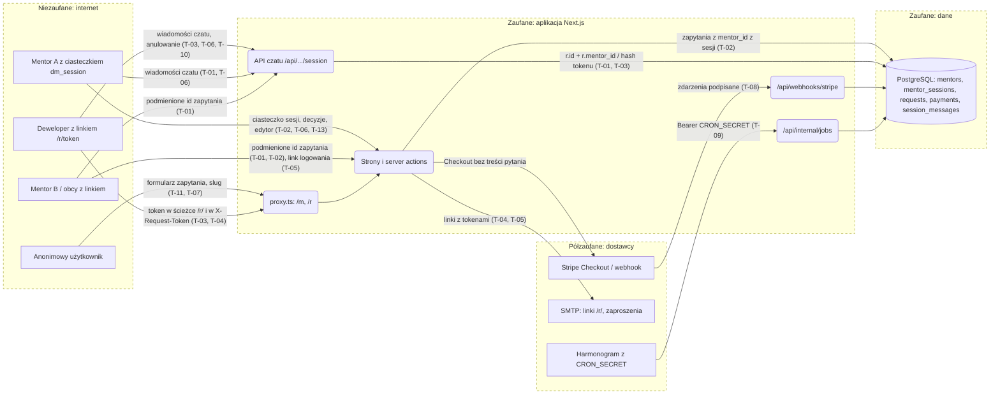

# Model zagrożeń: DevMentor

**Zakres:** cały system (aplikacja Next.js `app/` + `lib/` + `proxy.ts`, baza PostgreSQL, integracje Stripe, SMTP, harmonogram zadań). `packages/ui` to biblioteka komponentów bez własnych wejść — oceniana przez aplikację, która jej używa.
**Ostatnia aktualizacja:** 2026-11-03
**Właściciel:** Krzysztof Marczak (model przygotował agent, lekcja 16; do akceptacji)

DevMentor łączy deweloperów z mentorami: deweloper bez konta płaci z góry za 25/50 min czatu tekstowego, mentor (konto z zaproszenia, logowanie jednorazowym linkiem) przyjmuje albo odrzuca zapytanie i prowadzi sesję na czacie. Najważniejsze zagrożenia to **izolacja danych między mentorami** (cudze pytania, kwoty i czat po podmianie id zapytania) oraz **linki-tokeny na okaziciela** (`/r/{token}`, zaproszenia, linki logowania) — kto ma link, ten jest stroną sesji.

## 1. Nad czym pracujemy?

### Profil systemu

| Aplikacja | Typ | Stack | Wdrożenie | Uwierzytelnianie | Izolacja (tenancy) | AI |
| --- | --- | --- | --- | --- | --- | --- |
| DevMentor web | aplikacja przeglądarkowa + trasy API + server actions | Next.js 16.4 (App Router, `cacheComponents`), React 19, Node ≥ 20, `pg` | `next start` (produkcja nieustalona — założenie) | mentor: ciasteczko `dm_session` (httpOnly, SameSite=Lax, Secure w produkcji, 30 dni) → hash w `mentor_sessions`; deweloper: token 256 bit w linku `/r/{token}` (hash SHA-256 w `requests.access_token_hash`) | jeden „tenant” = mentor; każde zapytanie filtrowane po `mentor_id` z sesji | brak w działaniu aplikacji |
| Zadania okresowe | trasa `POST/GET /api/internal/jobs` + `scripts/jobs.mjs` | Node | wywołanie z harmonogramu | `Authorization: Bearer CRON_SECRET` (≥ 32 znaki, porównanie w stałym czasie) | — | brak |
| CLI założycieli | `scripts/mentor-links.mjs` | Node | lokalnie u założyciela | dostęp do `DATABASE_URL` | — | brak |

Architektura: monolit Next.js (strony, server actions, trasy API) z logiką domeny w `lib/**/*.mjs`.
Magazyny danych: PostgreSQL 17 (`mentors`, `mentor_sessions`, `invitations`, `mentor_sign_in_links`, `mentor_pages`, `availability_*`, `requests`, `payments`, `session_messages`, `outbound_emails`, `job_runs`).
Systemy zewnętrzne: Stripe (Checkout, zwroty, webhook podpisany), SMTP (e-maile z linkami), harmonogram zadań.
Izolacja: `mentorId` WYŁĄCZNIE z `getCurrentMentor()` (`lib/auth/session.ts:69`), egzekwowana w SQL (`lib/requests/mentor.mjs:99`, `lib/requests/decision.mjs:118`, `lib/sessions/messages.mjs:92`). Deweloper widzi tylko zapytanie wskazane hashem swojego tokenu.

### Zasoby (co chronimy)

- pytania deweloperów (treść, imię), czat sesji, kwoty i statusy płatności/zwrotów;
- e-mail płacącego (nigdy nie trafia do mentora), e-maile mentorów;
- sesje mentorów i linki-tokeny (zaproszenie 14 dni, logowanie 72 h, `/r/` do 30 dni po terminie);
- przychód mentora (decyzje akceptuj/odrzuć wywołują zwroty), sekrety `STRIPE_*`, `CRON_SECRET`, `DATABASE_URL`.

### Aktorzy

| Aktor | Dostęp | Motywacja |
| --- | --- | --- |
| Anonimowy użytkownik internetu | `/`, `/m/{slug}`, formularz zapytania, webhook, trasa zadań | spam zapytań, wyliczanie slugów/tokenów, osadzenie stron w ramce |
| Deweloper z linkiem `/r/{token}` | własne zapytanie, czat, anulowanie | czytanie cudzych sesji, pisanie jako mentor |
| Zalogowany mentor B | własny panel | odczyt/zmiana zapytań i czatu mentora A (podmiana id) |
| Osoba, której przekazano link (e-mail, zrzut ekranu, historia) | wszystko, co daje link | przejęcie sesji dewelopera albo konta mentora |
| Fałszywy nadawca webhooka / harmonogramu | `/api/webhooks/stripe`, `/api/internal/jobs` | oznaczenie nieopłaconego jako opłacone, wymuszenie zadań |
| Złośliwa zależność npm / skill agenta | build i praca agenta | łańcuch dostaw (L09) |

### Punkty wejścia

| Wejście | Uwierzytelnienie | Uwagi |
| --- | --- | --- |
| `GET /m/{slug}`, server action `startRequestAction` | brak | cena i termin liczone na serwerze (`lib/requests/start.mjs`), brak limitu częstości |
| `GET /r/{token}`, server action `cancelRequestAction` | token w ścieżce | `proxy.ts` daje 404 dla złego/wygasłego tokenu i `Referrer-Policy: no-referrer` |
| `GET/POST /api/r/session` | token w nagłówku `X-Request-Token` | `lib/sessions/server.ts:43` |
| `GET/POST /api/mentor/requests/{id}/session` | ciasteczko mentora | id z adresu niezaufane, zapytanie po `id` + `mentor_id` |
| `/mentor`, `/mentor/availability`, `/mentor/requests[/{id}]` + server actions zapisu i decyzji | ciasteczko mentora | każda akcja sama woła `getCurrentMentor()` |
| `/invite/{token}`, `/sign-in/{token}` + server actions | token linku | jednorazowe, hash w bazie, GET niczego nie zużywa |
| `POST /api/webhooks/stripe` | podpis `Stripe-Signature` | surowe ciało, `lib/payments/webhook.mjs` |
| `GET/POST /api/internal/jobs` | `Bearer CRON_SECRET` | 401 / 503 |

### Przepływ danych i granice zaufania

Granice: przeglądarka ↔ aplikacja; aplikacja ↔ baza; Stripe/harmonogram ↔ aplikacja; aplikacja ↔ skrzynka e-mail (linki na okaziciela).
Źródło diagramu: `docs/security/threat-model.mmd` (render: `npx @mermaid-js/mermaid-cli -i docs/security/threat-model.mmd -o docs/security/threat-model.svg` — nie renderowany, żeby nie instalować przeglądarki headless).

### Komponenty AI

Aplikacja nie ma komponentów AI w działaniu (brak LLM, agentów, narzędzi). Agenci kodujący i skille (`.claude/skills`, w tym `threat-model` z tej lekcji) działają tylko w czasie tworzenia kodu — ich ryzyko opisuje `lekcja-09/security-notes.md`. Werdykt Rule of Two: nie dotyczy.

### Założenia i otwarte pytania

- [ ] Środowisko produkcyjne i reverse proxy nie są ustalone — nagłówki bezpieczeństwa i HTTPS zakładamy po stronie aplikacji (`next.config.ts`).
- [ ] Ochrona server actions przed CSRF opiera się na wbudowanym w Next.js porównaniu `Origin` z `Host` — nie weryfikowane w tej lekcji ponad próbę z obcym `Origin` na czacie.
- [ ] Brak limitów częstości (rate limiting) — zakładamy, że da je platforma hostingowa; niepotwierdzone.
- [ ] E-maile z linkami idą przez SMTP bez gwarancji szyfrowania u odbiorcy.

## 2. Co może pójść źle?

| ID | Zagrożenie | STRIDE | Gdzie | L | I | Odpowiedź | Kontrola dziś | Jak weryfikujemy | OWASP / CWE |
| --- | --- | --- | --- | --- | --- | --- | --- | --- | --- |
| T-01 | Mentor B czyta albo pisze w czacie sesji mentora A, podmieniając id w `GET/POST /api/mentor/requests/{id}/session` (IDOR) | I, T, E | `lib/sessions/messages.mjs:91-93`, `lib/sessions/server.ts:45` | M | H | Mitygacja: `r.id = $2 and r.mentor_id = $3`, mentor z ciasteczka | Tak (SQL po `mentor_id`) | test `tests/db/session-messages.test.mjs` „izolacja”; próba HTTP dwoma kontami (`docs/security/kontrola-dostepu.md` G1) | A01:2025, API1:2023, CWE-639 |
| T-02 | Mentor B czyta szczegóły (pytanie, kwota) albo akceptuje/odrzuca zapytanie mentora A (`/mentor/requests/{id}`, `acceptRequestAction`, `declineRequestAction`) | I, T, E | `lib/requests/mentor.mjs:99`, `lib/requests/decision.mjs:118`, `lib/requests/mentor-area.ts:82` | M | H | Mitygacja: odczyt i `update` warunkowane `mentor_id` z sesji | Tak | testy `tests/db/requests-mentor.test.mjs`, `requests-decision.test.mjs`; próba HTTP (G3) | A01:2025, API1:2023, API5:2023, CWE-639, CWE-862 |
| T-03 | Pomylenie ról w czacie: posiadacz linku dewelopera pisze jako mentor (trasa mentora) albo mentor wysyła wiadomość jako deweloper (trasa `/api/r/session` z ciasteczkiem, bez tokenu) | S, E | `lib/sessions/server.ts:43-63`, `messages.mjs:188` (autor = rodzaj poświadczenia) | L | H | Mitygacja: autor wynika z trasy i poświadczenia, nie z treści żądania | Tak | próba HTTP (G2) | A01:2025, API5:2023, CWE-285 |
| T-04 | Link `/r/{token}` wycieka (przekazany e-mail, historia przeglądarki, logi serwera/proxy z adresem) → obcy czyta pytanie i czat, pisze jako deweloper, anuluje ze zwrotem; ważny do 30 dni po terminie, bez odwołania | I, S, T | `lib/requests/view.mjs:11`, `proxy.ts:52`, `app/r/[token]` | M | H | Do decyzji: krótszy TTL po sesji, unieważnienie/rotacja linku, potwierdzenie e-mailem przy anulowaniu | Częściowo: token 256 bit, hash w bazie, `Referrer-Policy: no-referrer` i `noindex` na `/r/*`, token API tylko w nagłówku | przegląd projektu; próba: token w logu dostępowym; issue | A01:2025, A07:2025, CWE-598, CWE-613 |
| T-05 | Link logowania / zaproszenia (na okaziciela) przechwycony albo przekazany → przejęcie konta mentora; nie ma potwierdzenia urządzenia ani powiadomienia o nowej sesji | S, E | `lib/auth/mentor-auth.mjs:224, 348`, `scripts/mentor-links.mjs` | L | H | Do decyzji: powiadomienie e-mailem o nowym logowaniu, lista/odwołanie sesji, krótszy TTL linku | Częściowo: jednorazowe, 72 h / 14 dni, hash, GET nie zużywa | testy `tests/db/mentor-auth.test.mjs`; issue | A07:2025, CWE-287, CWE-640 |
| T-06 | CSRF: obca strona wywołuje decyzję mentora, zapis edytora albo wiadomość czatu z ciasteczkiem ofiary | T | server actions, `lib/sessions/http.mjs:81` | L | M | Mitygacja | Tak: `SameSite=Lax`, server actions sprawdzają `Origin`, czat wymaga JSON + zgodnego `Origin` | test `session-chat.e2e.mjs` (obcy Origin → 403); ZAP | A01:2025, CWE-352 |
| T-07 | Brak nagłówków bezpieczeństwa: osadzenie panelu mentora w ramce (clickjacking decyzji), brak CSP (obrona w głąb przed XSS), MIME sniffing, Referer z adresem na stronach innych niż `/r/*`, ujawnienie `X-Powered-By: Next.js` | I, T | `next.config.ts` (brak `headers()`) | M | M | Mitygacja: nagłówki w `next.config.ts` | Brak | ZAP Baseline; test `tests/security/headers.test.mjs` | A02:2025, CWE-1021, CWE-693, CWE-200 |
| T-08 | Fałszywy albo powtórzony webhook Stripe oznacza płatność jako opłaconą | S, T | `app/api/webhooks/stripe/route.ts`, `lib/payments/webhook.mjs` | L | H | Mitygacja | Tak: podpis na surowym ciele, idempotencja zdarzeń | testy `tests/db/payments-webhook.test.mjs` | A08:2025, CWE-345 |
| T-09 | Wywołanie `/api/internal/jobs` bez sekretu albo zgadywanie sekretu | S, D | `app/api/internal/jobs/route.ts`, `lib/jobs/jobs.mjs` | L | M | Mitygacja | Tak: ≥ 32 znaki, stały czas, 503 bez konfiguracji | testy `tests/db/jobs.test.mjs` | A07:2025, CWE-306 |
| T-10 | Stored XSS przez opis mentora, link do pracy, pytanie albo wiadomość czatu | T, E | `packages/ui/src/product/**`, `lib/mentor-page/validate.mjs` | L | H | Mitygacja | Tak: render jako tekst (bez `dangerouslySetInnerHTML`), link tylko `http(s)://`, `rel="nofollow noopener ugc"`; brak CSP jako drugiej warstwy (T-07) | Semgrep (reguły React/Next.js); ZAP | A05:2025, CWE-79 |
| T-11 | Zalew zapytań/płatności (spam formularza, wyczerpanie terminów przez `awaiting_payment`), zalew wiadomości | D | `startRequestAction`, `/api/*/session` | M | M | Do decyzji: limit częstości na IP/slug | Częściowo: limit 16 KB treści, 500 wiadomości na sesję, wygasanie płatności; brak rate limitu | przegląd; bez testów obciążeniowych (poza zakresem) | API4:2023, API6:2023, CWE-770 |
| T-12 | Wyliczanie slugów/tokenów, ujawnienie stanu przez różne kody i komunikaty, stack trace w odpowiedzi | I | `proxy.ts`, `lib/sessions/server.ts:25` | L | L | Mitygacja | Tak: jednolite 404, błędy logują tylko nazwę | ZAP (komunikaty błędów) | A10:2025, CWE-209, CWE-204 |
| T-13 | Kradzież/utrwalenie sesji mentora: 30-dniowe ciasteczko bez wygasania bezczynności i bez „wyloguj wszędzie” | S | `lib/auth/session.ts:49`, `lib/auth/tokens.mjs:17` | L | H | Do decyzji: krótszy TTL / bezczynność, odwołanie wszystkich sesji | Częściowo: httpOnly, Secure w produkcji, SameSite=Lax, nowy token przy logowaniu, odwołanie sesji innego mentora | testy `tests/db/mentor-auth.test.mjs`; przegląd | A07:2025, CWE-613 |

## 3. Zakres testów

| Metoda | Co sprawdzić | Zagrożenia |
| --- | --- | --- |
| Testy integracyjne (`node --test`, baza) | izolacja czatu i zapytań po `mentor_id`, wygasłe tokeny, podpis webhooka, sekret zadań | T-01, T-02, T-05, T-08, T-09, T-13 |
| SAST (Semgrep CE) | reguły TypeScript, React/Next.js, OWASP Top 10 na `app/`, `lib/`, `packages/`, `proxy.ts` | T-10, T-12 |
| DAST (ZAP Baseline, bez sesji) | nagłówki bezpieczeństwa, ciasteczka, komunikaty błędów | T-06, T-07, T-12 |
| Ręcznie, dwa konta (curl, osobne cookie-jary) | G1 czat mentora, G2 role czatu, G3 szczegóły i decyzje — pozytywna ścieżka obu kont, odmowa odczytu, odmowa zapisu, stan danych po próbie | T-01, T-02, T-03 |
| Przegląd projektu | linki na okaziciela, TTL, odwołanie, limit częstości | T-04, T-05, T-11, T-13 |
| Prompt injection | nie dotyczy (brak AI w aplikacji) | — |

**Poza zakresem:** infrastruktura Stripe i SMTP, testy obciążeniowe i wolumetryczny DoS, zgadywanie haseł/tokenów, socjotechnika, produkcja i wspólne środowiska.

**Zasady prób:** wyłącznie jednorazowe środowisko z `.ai/scripts/test-env-up.sh` (schemat `dm_migtest_*`, `next start` na `127.0.0.1`), dane syntetyczne z `.ai/scripts/lesson-16-session.mjs` (dwóch mentorów, deweloperzy z linkami), fałszywy Stripe w procesie; nic poza localhost; wartości ciasteczek i tokenów nie są wypisywane.

## 4. Czy zrobiliśmy to dobrze?

- [x] Każda aplikacja w zakresie ma wiersz w profilu systemu
- [x] Każde wejście i każde przejście granicy na diagramie przeszło przez sześć liter STRIDE (R — wyparcie się: decyzje i wiadomości mają znaczniki czasu z bazy, brak dziennika audytu poza `job_runs`; nie wydzielone jako osobne zagrożenie przy obecnej skali)
- [x] Komponenty AI: nie dotyczy (opisane)
- [x] Każde zagrożenie High ma odpowiedź i weryfikację
- [x] Zagrożenia między „tenantami” (T-01, T-02) i między rolami (T-03) są w tabeli
- [x] Id zagrożeń opisane na przepływach diagramu
- [x] Założenia oznaczone, nie podane jako fakty
- [x] Dokument nie zawiera instrukcji ataku ani ładunków
- [x] Poza zakresem i zasady prób zapisane

## Changelog

- 2026-11-03 Pierwsza wersja modelu (lekcja 16, skill `threat-model` z `pat-lewczuk/skills`).
- 2026-11-03 T-07 mitygowane: nagłówki bezpieczeństwa w `next.config.ts` (issue #55, PR lekcji 16; ZAP po poprawce: 0 alertów 10020/10021/10037/10038/10063, nowy 10055 `unsafe-inline` do akceptacji). Granice T-01–T-03 sprawdzone próbą HTTP dwoma kontami (`docs/security/kontrola-dostepu.md`: PASS). Do decyzji: T-04 (issue #57), T-05 i T-13 (issue #58).
